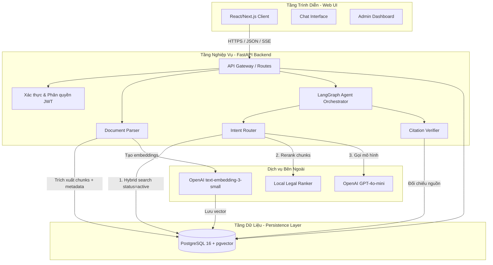
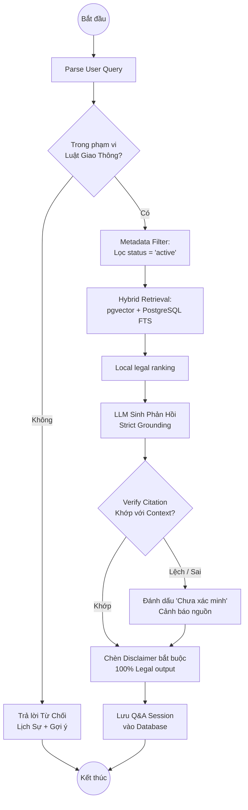
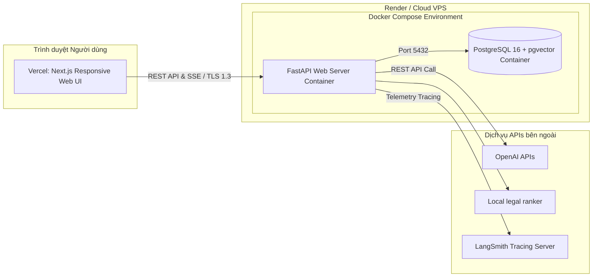

# Sơ đồ Kiến trúc Hệ thống (Architecture Diagrams)

Tài liệu này chứa các sơ đồ kiến trúc hệ thống và luồng xử lý chi tiết cho dự án **AI Trợ Lý Tra Cứu & Tuân Thủ Quy Định Giao Thông Vận Tải Đường Bộ**. 

> [!NOTE]
> Để xem chi tiết các đặc tả thành phần và thiết kế Cơ sở Dữ liệu, vui lòng tham khảo [docs/project/05-architecture.md](project/05-architecture.md) và [docs/project/06-database-schema.md](project/06-database-schema.md).

---

## 1. Sơ đồ Kiến trúc Tổng quan (System Overview)
Sơ đồ mô tả luồng truyền dữ liệu từ Client (Next.js) qua FastAPI, điều phối bằng LangGraph Agent, truy vấn PostgreSQL + pgvector và tương tác với các mô hình LLM/Embedding/Reranker.

---

## 2. Luồng Trực quan của Agent (LangGraph Flow)
Agent được thiết kế dưới dạng Máy trạng thái (State Machine) bằng LangGraph, có kiểm soát đầu ra nghiêm ngặt để phát hiện và ngăn chặn hallucination (sự suy diễn sai lệch của mô hình ngôn ngữ lớn).

---

## 3. Bản đồ Triển khai (Deployment Topology)
Mô tả cách thức container hóa các dịch vụ trong môi trường phát triển (Local Docker Compose) hoặc khi chạy thực tế trên Cloud (Render & Vercel).

