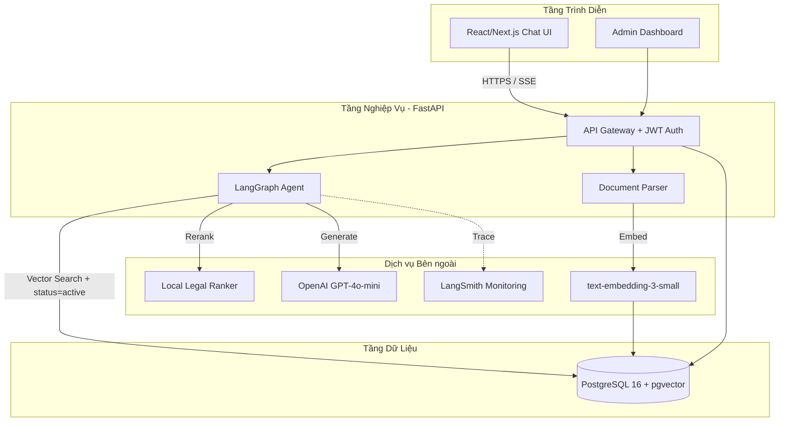
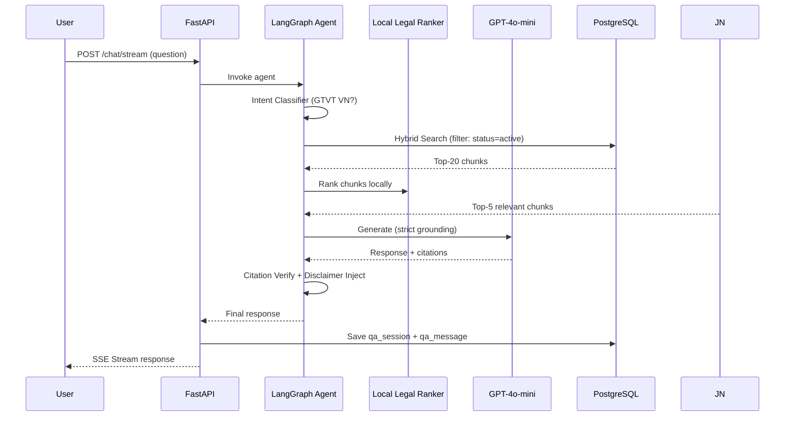

## Tổng quan

Hệ thống **AI Trợ lý Tra cứu & Tuân thủ Quy định Giao thông Vận tải** là một LLM + RAG chatbot chuyên ngành phục vụ người dùng tra cứu quy định pháp luật GTVT Việt Nam. Kiến trúc được thiết kế theo **3-Tier** với RAG pipeline đầy đủ.

> Chi tiết đầy đủ xem tại [`docs/project/05-architecture.md`](../../project/05-architecture.md) và [`docs/project/`](../../project/)

---

## Sơ đồ Kiến trúc Tổng quan

---

## RAG Pipeline Flow

---

## Components

### 1. Frontend (React / Next.js)

- **Chat Interface**: SSE streaming, Markdown rendering, Citation click-through
- **Admin Dashboard**: Upload văn bản, HITL approval, User management, AI quality metrics
- **Alert Panel**: In-app notifications khi có luật mới

### 2. Backend (FastAPI)

| Route Group | Mô tả |
|---|---|
| `/auth` | Đăng ký / Đăng nhập / JWT |
| `/chat/stream` | SSE streaming Q&A với Agent |
| `/admin/kb` | Upload, review, approve văn bản pháp luật (HITL) |
| `/admin/users` | CRUD user, phân quyền ADMIN/USER |
| `/notifications` | In-app alert notifications |
| `/bookmarks` | Lưu câu hỏi / đoạn luật quan trọng |
| `/health` | Health check + AI quality metrics |

### 3. AI Agent (LangGraph State Machine)

**Nodes:**
1. **Intent Classifier** — Lọc câu hỏi ngoài phạm vi luật GTVT (Fast Embedder)
2. **Retriever** — Hybrid Search trên pgvector (Vector + BM25) với filter `status=active` bắt buộc
3. **Local ranker** — xếp hạng top-K bằng hybrid, lexical và legal-reference signals
4. **Generator** — GPT-4o-mini với strict grounding prompt
5. **Citation Verifier** — Đối chiếu trích dẫn với KB
6. **Disclaimer Injector** — Chèn disclaimer 100% outputs

### 4. Database (PostgreSQL 16)

| Bảng | Mục đích |
|---|---|
| `users` | Tài khoản + phân quyền |
| `legal_documents` | Văn bản pháp luật gốc + metadata hiệu lực |
| `document_chunks` | Chunks đã chunking + `status` denormalized |
| `qa_sessions` | Phiên hội thoại |
| `qa_messages` | Chi tiết Q&A + citations + faithfulness score |
| `bookmarks` | Bookmark của USER |
| `in_app_notifications` | Alert thông báo luật mới |
| `kb_update_queue` | HITL approval queue |

> DDL đầy đủ xem tại [`06-database-schema.md`](../../project/06-database-schema.md)

### 5. Vector Store (pgvector)

- **Embedding**: OpenAI `text-embedding-3-small` (1536 chiều)
- **Metadata filter bắt buộc**: `status = 'active'` trước mọi vector search
- **Parent-Child Chunking**: Enrich nội dung text với thông tin phân cấp (Chương/Điều/Khoản).
- Tích hợp chung với cơ sở dữ liệu quan hệ, không cần sync worker.

---

## Design Decisions

| Quyết định | Lựa chọn | Lý do |
|---|---|---|
| **Framework** | FastAPI | Async, auto-docs Swagger, type-safe Pydantic |
| **Agent** | LangGraph | State machine linh hoạt, hỗ trợ conditional branching |
| **Relational & Vector DB** | PostgreSQL 16+ (pgvector) | PostgreSQL lưu cả dữ liệu nghiệp vụ và Vector. Đảm bảo Transaction ACID. |
| **LLM** | GPT-4o-mini | Tốc độ nhanh, chi phí thấp, đủ chất lượng cho RAG |
| **Embedding** | text-embedding-3-small | 1536 chiều, nhất quán hệ sinh thái OpenAI |
| **Context ranker** | Local legal ranker | Deterministic, không gọi network, ưu tiên locator pháp lý |
| **Guardrail** | Disclaimer 100% + Scope Filter | Tuân thủ Luật AI VN 134/2025/QH15 |

---

## Non-Functional Requirements

| Yêu cầu | Chỉ tiêu |
|---|---|
| **P95 Latency** | ≤ 5 giây |
| **Hallucination Rate** | ≤ 5% |
| **Active Filter Compliance** | 100% (zero tolerance) |
| **Out-of-scope Deflection** | ≥ 90% |
| **Disclaimer Coverage** | 100% |
| **Uptime** | ≥ 99.5% |

---

*Tài liệu liên quan: [docs/project/05-architecture.md](../../project/05-architecture.md) · [04-api-spec.md](../../project/04-api-spec.md) · [06-database-schema.md](../../project/06-database-schema.md) · [09-rag-overview.md](../../project/09-rag-overview.md)*
