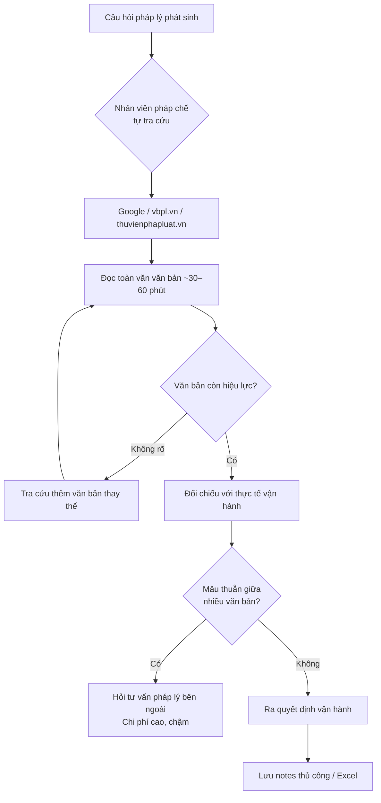
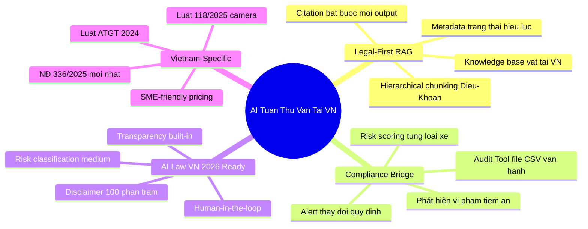
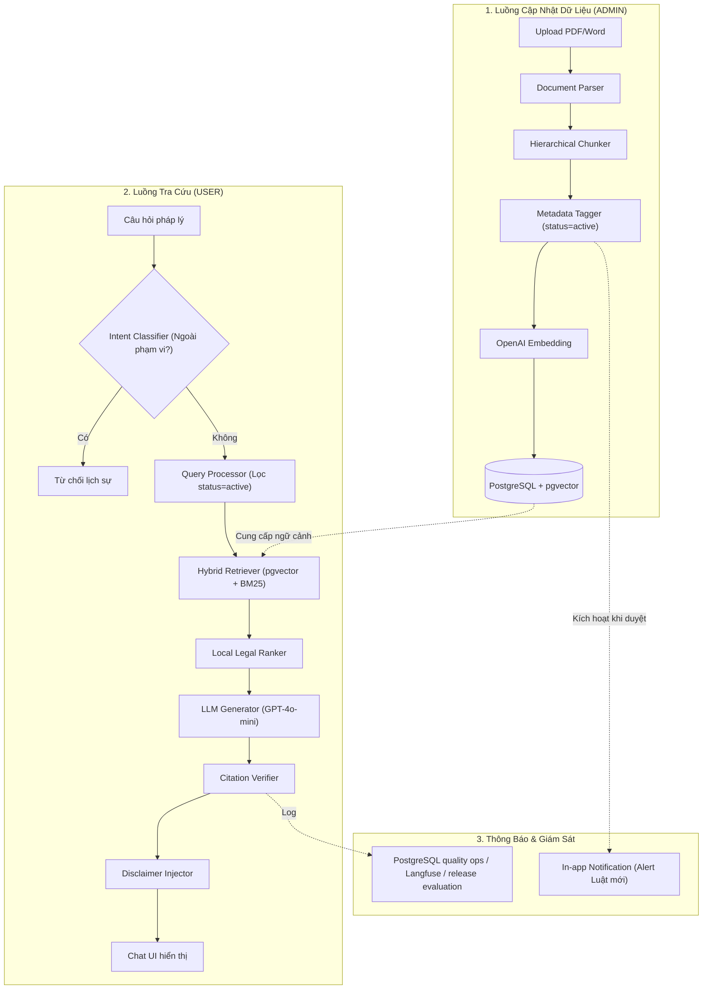

# BƯỚC 1: RESEARCH BRIEF
## AI Trợ Lý Tra Cứu & Tuân Thủ Quy Định Giao Thông Vận Tải Đường Bộ

| Mục | Nội dung |
|---|---|
| **Mã dự án** | 247 |
| **Lĩnh vực** | Vận tải & Logistics - Legal Compliance AI |
| **Loại giải pháp** | LLM + RAG + Chatbot Tra cứu |
| **Ngày tạo** | 05/06/2026 |
| **Phiên bản** | v2.0 (Cập nhật đơn giản hóa) |
| **Tech Stack (định hướng)** | OpenAI (GPT-4o-mini) · RAG (văn bản pháp luật) · FastAPI · Python · Chat UI (Web Responsive) |

---

## Mục lục

1. [Bối cảnh và Tổng quan vấn đề](#1-bối-cảnh-và-tổng-quan-vấn-đề)
2. [User Persona - Ai là người dùng chính?](#2-user-persona--ai-là-người-dùng-chính)
3. [Problem Statement - Vấn đề cốt lõi](#3-problem-statement--vấn-đề-cốt-lõi)
4. [Competitor Analysis - Phân tích đối thủ](#4-competitor-analysis--phân-tích-đối-thủ)
5. [Gap Analysis - Khoảng trống thị trường](#5-gap-analysis--khoảng-trống-thị-trường)
6. [Điểm khác biệt đề xuất của hệ thống](#6-điểm-khác-biệt-đề-xuất-của-hệ-thống)
7. [Kết luận và Hướng đi](#7-kết-luận-và-hướng-đi)

---

## 1. Bối cảnh và Tổng quan vấn đề

### 1.1 Bức tranh ngành vận tải đường bộ Việt Nam (2025–2026)

Ngành vận tải đường bộ Việt Nam đang trải qua giai đoạn tái cấu trúc pháp lý mạnh mẽ nhất trong thập kỷ. Chỉ trong vòng 18 tháng từ đầu 2025 đến giữa 2026, ít nhất 5 văn bản quy phạm pháp luật lớn có hiệu lực hoặc sửa đổi, tác động trực tiếp đến hoạt động của hàng chục nghìn doanh nghiệp và cá nhân tham gia giao thông.

| Chỉ số thị trường | Giá trị |
|---|---|
| **Số DN vận tải đường bộ** | ~10.300+ DN mới thành lập trong năm 2025 (nguồn: VATA) |
| **Quy mô phổ biến** | SME 5–50 đầu xe chiếm đại đa số |
| **Mức phạt tối đa theo NĐ 336/2025** | Lên đến 150 triệu đồng/vụ (tổ chức) |
| **Phạt không có GPKD vận tải** | 32 triệu đồng/tổ chức (từ 01/03/2026) |
| **Thời gian tra cứu thủ công** | ~30 phút/câu hỏi pháp lý (ước tính) |
| **Số văn bản cần theo dõi** | 50–200 văn bản tùy loại hình hoạt động |

### 1.2 Các văn bản pháp lý trọng yếu cần theo dõi

| Văn bản | Nội dung cốt lõi | Trạng thái |
|---|---|---|
| Luật Trật tự, ATGT đường bộ 2024 | Điều kiện lưu thông, thời gian lái xe ≤ 4h/lần, an toàn phương tiện | Hiệu lực 01/01/2025 |
| Nghị định 168/2024/NĐ-CP | Xử phạt về trật tự, an toàn giao thông đường bộ; trừ/phục hồi điểm GPLX | Hiệu lực 01/01/2025 |
| Nghị định 336/2025/NĐ-CP | Xử phạt vi phạm hành chính trong hoạt động đường bộ | Hiệu lực 01/03/2026 |
| Nghị định 10/2020/NĐ-CP + sửa đổi | Điều kiện kinh doanh vận tải bằng xe ô tô | Một phần đã sửa đổi |
| Luật số 118/2025/QH15 | Camera giám sát tài xế bắt buộc; bỏ giới hạn 48h/tuần (chuyển sang Bộ luật Lao động) | Hiệu lực 01/07/2026 |
| Luật AI số 134/2025/QH15 | Khung pháp lý quản lý hệ thống AI - phân loại rủi ro, nghĩa vụ transparency | Hiệu lực 01/03/2026 |
| Thông tư hướng dẫn Bộ GTVT | Tiêu chuẩn kỹ thuật, khí thải, đăng kiểm | Cập nhật liên tục |

### 1.3 Quy trình tra cứu tuân thủ hiện tại (AS-IS)

**Điểm nghẽn chính:** Không có hệ thống nào tự động theo dõi hiệu lực văn bản, cảnh báo mâu thuẫn pháp lý, và giúp tra cứu nhanh bằng ngôn ngữ tự nhiên tiếng Việt cho người dùng đại chúng.

---

## 2. User Persona - Ai là người dùng chính?

### 2.1 Persona 1: Người dùng tra cứu luật (USER - Primary User)

| Thuộc tính | Mô tả |
|---|---|
| **Đại diện** | Người lái xe, chủ xe cá nhân, điều vận viên hoặc nhân viên phụ trách vận tải |
| **Thiết bị** | Smartphone (Responsive Web) hoặc Máy tính |
| **Kỹ năng công nghệ** | Thấp đến Trung bình (quen dùng Zalo, Facebook, tìm kiếm Google cơ bản) |
| **Mục tiêu** | Tra cứu nhanh chóng các điều luật GTVT; kiểm tra mức phạt của hành vi cụ thể; xem luật mới nhất có hiệu lực hay chưa |
| **Pain points** | Sợ áp dụng văn bản cũ hoặc nhầm nguồn hiện hành theo từng nhóm hành vi (NĐ 168 về trật tự, ATGT; NĐ 336 về hoạt động đường bộ); ngôn ngữ pháp lý khó hiểu; tra cứu Google mất thời gian và dễ sai |
| **Quote** | *"Tôi cần biết ngay mức phạt cho hành vi này là bao nhiêu theo luật mới nhất, giao diện đơn giản trên điện thoại càng tốt."* |

### 2.2 Persona 2: Quản trị viên hệ thống (ADMIN - Secondary User)

| Thuộc tính | Mô tả |
|---|---|
| **Đại diện** | Quản trị viên CNTT hoặc Trưởng bộ phận phụ trách nội dung pháp luật |
| **Thiết bị** | Máy tính / Laptop |
| **Kỹ năng công nghệ** | Tốt |
| **Mục tiêu** | Cập nhật CSDL luật chính xác; phê duyệt văn bản mới đưa vào KB (HITL); giám sát các chỉ số chất lượng AI; quản lý tài khoản người dùng |
| **Pain points** | Sợ AI bị hallucinate hoặc trả lời sai cho người dùng; cập nhật CSDL luật thủ công tốn thời gian; khó theo dõi lịch sử truy cập và phân quyền |
| **Quote** | *"Tôi cần một công cụ trực quan để cập nhật văn bản luật, giám sát độ chính xác của AI và phân quyền cho người sử dụng."* |

---

## 3. Problem Statement - Vấn đề cốt lõi

### 3.1 Bốn nhóm vấn đề chính (Pain Point Map)

| Mức độ | Vấn đề | Tác động thực tế |
|---|---|---|
| 🔴 **P1 - Nghiêm trọng** | Bị động trước "bão" thay đổi pháp lý | Các nhóm quy định trước đây nằm trong NĐ 100 nay phải đối chiếu theo phạm vi NĐ 168/2024 và NĐ 336/2025; Luật 118/2025 tiếp tục thay đổi từ 01/07/2026. |
| 🔴 **P1 - Nghiêm trọng** | AI thông thường hallucinate văn bản pháp luật | ChatGPT/Claude không có RAG dễ trích dẫn NĐ 100 đã hết hiệu lực, hoặc bịa điều khoản - hậu quả nghiêm trọng nếu người dùng tin theo. |
| 🟠 **P2 - Quan trọng** | Văn bản chồng chéo, mâu thuẫn giữa các bộ/ngành | Thời gian lái: Luật ATGT 2024 quy định ≤4h liên tục; Luật 118/2025 bãi bỏ giới hạn 48h/tuần chuyển sang Bộ luật Lao động → hai nguồn khác nhau gây bối rối cho người tra cứu. |
| 🟡 **P3 - Đáng chú ý** | Tốn thời gian tra cứu thủ công và bỏ sót thông tin | Phải đọc hàng trăm trang văn bản thô để tìm một mức phạt cụ thể; không có hệ thống cảnh báo khi cơ sở dữ liệu luật thay đổi. |

### 3.2 Bài toán kỹ thuật cốt lõi

> **Xây dựng hệ thống RAG chuyên ngành vận tải đường bộ Việt Nam với knowledge base văn bản pháp luật có metadata trạng thái hiệu lực, trả lời câu hỏi kèm trích dẫn nguồn chi tiết (Điều, Khoản), hỗ trợ in-app notification khi có luật mới, quản lý người dùng và có guardrail nghiêm ngặt - vận hành trong khuôn khổ Luật AI VN 134/2025/QH15.**

**Yêu cầu kỹ thuật tối thiểu để hệ thống đáng tin cậy:**

1. **Metadata filtering bắt buộc**: mỗi chunk văn bản phải có `{ status: active/repealed, effective_date, replaced_by }` - vector search thuần không phân biệt văn bản còn/hết hiệu lực.
2. **Hierarchical chunking**: cấu trúc Chương → Điều → Khoản → Điểm phải được bảo toàn, không cắt theo độ dài thô.
3. **Citation-grounded generation**: LLM phải trả lời chỉ dựa trên context đã retrieve, không suy diễn ngoài.
4. **Guardrail disclaimer 100%**: mọi câu trả lời pháp lý phải có cảnh báo "chỉ mang tính tham khảo" - yêu cầu của Luật AI VN 2026.

---

## 4. Competitor Analysis - Phân tích đối thủ

### 4.1 Nhóm A: Công cụ Legal AI toàn cầu

#### A1. Harvey AI (harvey.ai)
- **Loại**: Legal AI toàn diện - nghiên cứu pháp luật, soạn thảo hợp đồng.
- **Thị trường**: Luật sư/công ty luật lớn, tập trung luật Mỹ-Anh.
- **Điểm mạnh**: GPT-4 fine-tuned cho pháp lý; citation chất lượng cao; tích hợp sâu với workflow công ty luật.
- **Điểm yếu**: Không có văn bản pháp luật Việt Nam; không chuyên ngành vận tải; giá cao (enterprise only).
- **Bài học rút ra**: Citation quality là yêu cầu không thể bỏ qua - người dùng cần click-through đến nguồn gốc.

#### A2. Westlaw AI / LexisNexis Lexis+ AI
- **Loại**: Legal Research AI tích hợp vào database án lệ và luật.
- **Thị trường**: Luật sư Mỹ, tập đoàn lớn.
- **Điểm mạnh**: Database án lệ khổng lồ; RAG từ primary law sources; uy tín pháp lý cao.
- **Điểm yếu**: Hallucination rate 17–33% (theo Stanford HAI & Harvard JOLT, 2025); không có VN law; chi phí rất cao.
- **Bài học rút ra**: RAG không "triệt tiêu" hoàn toàn hallucination - cần evaluation set nghiêm túc và disclaimer rõ ràng.

### 4.2 Nhóm B: Fleet Management & Compliance Software (toàn cầu)

#### B1. Samsara / Motive
- **Loại**: AI Fleet Management + compliance vận hành.
- **Điểm mạnh**: HOS tracking tự động; AI dashcam; compliance automation mạnh mẽ.
- **Điểm yếu**: Không hỗ trợ pháp luật Việt Nam; không có Q&A pháp lý tự nhiên.
- **Bài học rút ra**: Giao diện trực quan và dễ sử dụng là yếu tố quyết định cho người dùng phi công nghệ.

### 4.3 Nhóm C: Giải pháp pháp lý Việt Nam hiện tại

#### C1. Thư viện Pháp luật (thuvienphapluat.vn) + vbpl.vn
- **Loại**: Legal database + tra cứu văn bản.
- **Điểm mạnh**: Database văn bản VN đầy đủ; chú thích hiệu lực tốt.
- **Điểm yếu**: Tra cứu keyword thủ công; không có Q&A tự nhiên; không tổng hợp đa văn bản; không cảnh báo mâu thuẫn.
- **Bài học rút ra**: Nguồn dữ liệu vàng để xây KB; nhưng trải nghiệm người dùng yếu cần AI layer phía trên.

### 4.4 Bảng so sánh tổng hợp

| Tính năng | Harvey AI | Westlaw AI | Samsara | TVPL.vn | **Hệ thống đề xuất** |
|---|:---:|:---:|:---:|:---:|:---:|
| Q&A pháp lý tự nhiên | Có | Có | Không | Không | **Có** |
| Văn bản pháp luật Việt Nam | Không | Không | Không | Có | **Có** |
| Chuyên ngành vận tải VN | Không | Không | Không | Hạn chế | **Có** |
| Metadata trạng thái hiệu lực | Hạn chế | Có | N/A | Có | **Có (bắt buộc)** |
| Cảnh báo thay đổi quy định | Không | Hạn chế | Hạn chế | Không | **Có (in-app)** |
| Quản lý tài khoản & phân quyền | Có | Có | Có | Có | **Có** |
| Guardrail / Disclaimer | Có | Có | N/A | Không | **Có (100%)** |
| Tuân thủ Luật AI VN 2026 | N/A | N/A | N/A | N/A | **Có (by design)** |

---

## 5. Gap Analysis - Khoảng trống thị trường

### 5.1 Những gì đối thủ làm tốt (Best Practices cần học)
1. **Citation-grounded answers**: Mọi câu trả lời phải link được đến nguồn pháp lý gốc.
2. **Legal database quality**: Nguồn văn bản VN đầy đủ và có chú thích hiệu lực rõ ràng.
3. **Risk-based disclaimers**: Disclaimer bắt buộc để tránh rủi ro pháp lý cho hệ thống AI.
4. **Metadata filtering**: Phân biệt văn bản còn/hết hiệu lực là nền tảng độ tin cậy.

### 5.2 Khoảng trống chưa ai lấp (Gaps)
- **Không có legal AI chuyên ngành vận tải VN**: Người dùng phải tự đọc văn bản thô cực kỳ tốn thời gian.
- **Thiếu xử lý mâu thuẫn văn bản**: Không có tool nào cảnh báo và giải thích khi các văn bản quy định chồng chéo.
- **Metadata trạng thái hiệu lực chưa machine-readable**: Cần tag metadata thủ công hoặc bán tự động bởi ADMIN để hệ thống RAG lọc chính xác.

### 5.3 Kết luận Gap Analysis
Không có giải pháp nào trên thị trường Việt Nam kết hợp được đồng thời 4 yếu tố:
1. RAG từ KB văn bản pháp luật vận tải đường bộ Việt Nam có bộ lọc metadata hiệu lực.
2. Q&A tự nhiên bằng tiếng Việt kèm trích dẫn Điều-Khoản có highlight chi tiết.
3. In-app Alert thông báo khi cơ sở dữ liệu luật được ADMIN cập nhật.
4. Quản lý người dùng, phân quyền truy cập và giám sát chất lượng RAG (HITL).

---

## 6. Điểm khác biệt đề xuất của hệ thống

### 6.1 Unique Value Proposition (UVP)

> **"Trợ lý AI đầu tiên chuyên ngành vận tải đường bộ Việt Nam: tra cứu quy định nhanh chóng với trích dẫn chính xác Điều-Khoản, tự động hiển thị cảnh báo in-app khi luật thay đổi, hỗ trợ ADMIN quản lý người dùng và duyệt dữ liệu luật trực quan, đảm bảo tuân thủ Luật AI VN 2026."**

### 6.2 Core Differentiators

### 6.3 So sánh WITH vs WITHOUT hệ thống

| Tiêu chí | WITHOUT (Hiện tại) | WITH (Hệ thống đề xuất) |
|---|---|---|
| **Tra cứu quy định** | 30 phút / câu hỏi, tra Google thủ công | <30 giây / câu hỏi, kèm trích dẫn Điều-Khoản |
| **Độ chính xác** | Dễ dùng văn bản hết hiệu lực | Metadata filter: chỉ trả về văn bản còn hiệu lực |
| **Mâu thuẫn văn bản** | Không phát hiện được | Cảnh báo khi hai văn bản mâu thuẫn cùng chủ đề |
| **Cập nhật pháp lý** | Phát hiện trễ, thụ động | In-app alert tức thời khi ADMIN duyệt văn bản mới |
| **Quản trị người dùng** | Không có hoặc quản lý thủ công | ADMIN quản lý tài khoản và phân quyền tập trung |
| **Tuân thủ Luật AI** | Không áp dụng | Tuân thủ Luật AI VN |

### 6.4 Kiến trúc kỹ thuật đề xuất

**Stack đề xuất:**

| Tầng | Công nghệ | Lý do chọn |
|---|---|---|
| **LLM** | OpenAI GPT-4o-mini | Mô hình tối ưu chi phí và hiệu năng cho RAG |
| **Orchestration** | LangChain / LlamaIndex | Pipeline RAG, metadata filtering mạnh mẽ |
| **Vector DB** | PostgreSQL (pgvector) | Tích hợp sẵn chung với DB quan hệ, không cần đồng bộ (sync), nhất quán dữ liệu 100% |
| **Embedding** | OpenAI text-embedding-3-small | Hiệu năng cao, tối ưu chi phí, nhất quán với hệ sinh thái OpenAI |
| **Xếp hạng ngữ cảnh** | Local legal ranker | Kết hợp hybrid score, lexical coverage và tín hiệu Điều/Khoản trước khi sinh câu trả lời |
| **API Backend** | FastAPI (Python) | Async, hiệu năng cao, dễ tích hợp |
| **Monitoring** | PostgreSQL quality ops + optional Langfuse + release evaluation | Coverage, actionable issues, release evidence và trace correlation |

---

## 7. Kết luận và Hướng đi

### 7.1 Tổng kết
- **Vấn đề thực tiễn**: Làn sóng đổi mới pháp lý (NĐ 336/2025, Luật 118/2025) tạo áp lực tra cứu luật GTVT rất lớn.
- **Giải pháp tối giản**: Phát triển chatbot tra cứu web responsive 2 vai trò USER & ADMIN, tập trung vào khả năng phản hồi chính xác, citation minh bạch và quản lý dữ liệu trực quan.
- **Tuân thủ Luật AI**: Hệ thống có disclaimer rõ ràng và quy trình HITL để đảm bảo an toàn thông tin pháp luật.

### 7.2 Khuyến nghị hướng đi theo độ ưu tiên

| Ưu tiên | Hành động | Lý do |
|---|---|---|
| **P0** | Xây dựng CSDL luật GTVT với metadata chuẩn + Bộ lọc metadata filter `status=active` | Đảm bảo tính chính xác cơ bản, không bị lẫn văn bản hết hiệu lực |
| **P1** | Pipeline RAG + Chat UI Responsive + Citation Verifier + Disclaimer | Core product cho người dùng tra cứu |
| **P1** | Giao diện ADMIN KB Manager (Upload thủ công) & User Management | Cho phép ADMIN kiểm soát dữ liệu và người dùng |
| **P2** | In-app notification alert cho USER khi có luật mới | Giúp người dùng cập nhật thay đổi tức thời |
| **P2** | AI Quality Monitoring Dashboard | Theo dõi và tinh chỉnh hệ thống AI dựa trên số liệu thực tế |
| **P3** | So sánh văn bản (Version Diff) & Phát hiện mâu thuẫn (Phase 2+) | Nâng cao chất lượng tra cứu đa nguồn |

