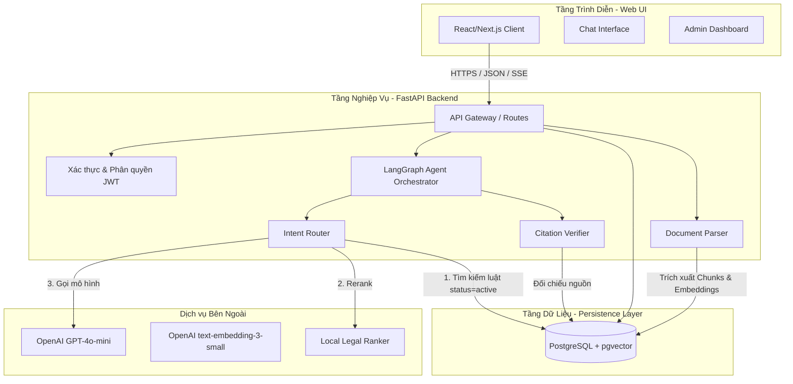
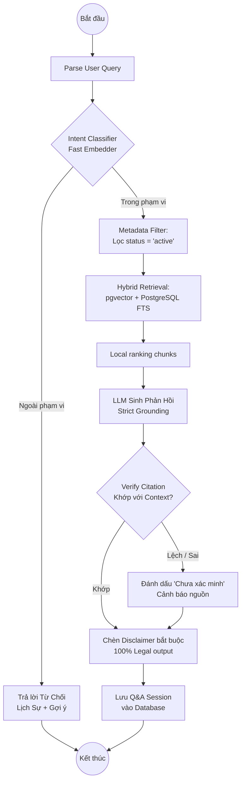

# Kiến trúc Hệ thống & Thiết kế Database
## Trợ Lý AI Tra Cứu & Tuân Thủ Quy Định Giao Thông Vận Tải Đường Bộ (Project 247)

Tài liệu này đặc tả chi tiết kiến trúc hệ thống, luồng xử lý và mô hình cơ sở dữ liệu cho hệ thống Trợ lý AI Tra cứu & Tuân thủ Luật Giao thông đường bộ Việt Nam.

---

## 1. Sơ đồ Kiến trúc Hệ thống (Architecture Diagrams)

### 1.1 Sơ đồ Kiến trúc Tổng quan (System Overview)
Hệ thống được thiết kế theo kiến trúc 3 tầng (Three-Tier Architecture) giúp tách biệt trách nhiệm (Separation of Concerns), dễ dàng mở rộng và bảo trì.



### 1.2 Luồng Xử Lý của Agent (LangGraph Agent Flow)
Agent hoạt động dưới dạng Máy trạng thái (State Machine) của LangGraph, xử lý các câu hỏi thông qua vòng lặp phản hồi có kiểm soát.



---

## 2. Chi tiết các Thành phần Hệ thống (Components)

### 2.1 Frontend (React / Next.js)
*   **Trách nhiệm:** Trình diễn giao diện người dùng và tương tác thời gian thực.
*   **Các tính năng chính:**
    *   **Chat Interface:** Giao diện trò chuyện tương tác cao, hỗ trợ **SSE Streaming** (hiển thị từng chữ khi AI phản hồi), hiển thị Markdown và các khối trích dẫn nguồn.
    *   **Citation Viewer:** Cho phép click vào các Điều/Khoản trích dẫn để mở panel phụ hiển thị toàn văn nội dung gốc được highlight.
    *   **Public-first Header:** Khách public thấy `Đăng ký` và `Đăng nhập`; người dùng đã đăng nhập thấy avatar, tên bị cắt theo bề rộng thực tế, dropdown hồ sơ và đăng xuất.
    *   **Admin Dashboard:** Khu vực dành riêng cho ADMIN để upload tài liệu pháp luật (PDF/Word), xem kho văn bản, mở hồ sơ duyệt theo queue, chỉnh metadata nháp và phê duyệt / từ chối trước khi xuất bản.
    *   **Alert Panel:** USER đăng nhập nhận thông báo realtime qua SSE ngay khi admin approve và publish văn bản; public chỉ thấy hướng dẫn đăng nhập.
*   **Tối ưu tải trang:** View tra cứu được tải trong bundle đầu; các view chat, admin và dashboard dùng dynamic import và chỉ render khi được chọn.
*   **Font:** Be Vietnam Pro được đóng gói cục bộ qua `@fontsource/be-vietnam-pro`, có bộ glyph tiếng Việt đầy đủ và không phụ thuộc Google Fonts khi dev/build.
*   **UI shell:** Sidebar navy + accent amber, header cố định và content area dùng design tokens Tailwind trong `globals.css`; trên mobile sidebar chuyển thành drawer có backdrop và hỗ trợ phím Escape. Navbar/sidebar public/USER giữ 4 mục chính: `Tra cứu văn bản`, `Hỏi đáp pháp luật`, `Thông báo`, `Đã lưu`; tài khoản `ADMIN` thấy thêm nhóm `Quản trị` cho KB, HITL, quality và user management.
*   **Styling pipeline:** Tailwind CSS 4 chạy qua plugin `@tailwindcss/postcss`. Design tokens, base styles và các component class ổn định được khai báo trong `globals.css`; markup đặc thù dùng utility class trực tiếp.
*   **Component primitives:** `src/components/ui/index.tsx` cung cấp `PageFrame`, `Panel`, `MetricCard`, `TableShell` và `EmptyView` cho các màn hình quản trị và trạng thái rỗng.
*   **Accessibility:** Có skip-link, focus-visible states, `aria-current` cho điều hướng, drawer mobile có backdrop và reduced-motion fallback.
*   **Document Search UX:** Từ khóa, loại văn bản, cơ quan và năm hiệu lực dùng chung một trạng thái áp dụng; filter chips cho phép bỏ từng điều kiện, phân trang giữ nguyên bộ lọc và vùng kết quả cuộn độc lập.
*   **Legal Document Reader:** Trình đọc dùng chung ở cấp ứng dụng được mở từ Tra cứu hoặc Kho văn bản. Frontend prefetch khi pointer/focus thể hiện ý định đọc, cache Promise theo `doc_id` để chống request trùng, lưu vị trí cuộn trong `sessionStorage` và giữ nguyên state của view phía sau. Reader hỗ trợ hai mode: public cho văn bản `active` và admin cho hồ sơ `pending_review` / `repealed`.
*   **User Management:** Màn ADMIN lấy dữ liệu thật từ `/api/v1/admin/users`, hỗ trợ tìm/lọc/phân trang, tạo hoặc sửa tài khoản, phân quyền, khóa/mở khóa, đặt lại mật khẩu và xuất CSV. Mobile dùng danh sách thẻ thay cho bảng ngang.
*   **Source-first Access:** Không mở reader nội bộ cho văn bản pháp luật đã parse lại. Khi cần đối chiếu, người dùng mở `source_url` hoặc tải file nguồn đã được duyệt từ backend.
*   **AI Quality Operations:** Dashboard admin ưu tiên verdict, coverage và action queue. Không kết luận `healthy` khi release check invalid hoặc production observation chưa đủ; issue detail luôn đi kèm evidence và review audit.

### 2.2 Backend (FastAPI)
*   **Trách nhiệm:** Cung cấp API gateway, xác thực, phân quyền và điều phối luồng nghiệp vụ.
*   **Các API chính:**
    *   `/api/v1/auth/`: Đăng ký, đăng nhập và cấp mã Token JWT.
    *   `/api/v1/auth/me`: Đọc/cập nhật hồ sơ người dùng hiện tại, đổi mật khẩu và đăng xuất.
    *   `/api/v1/chat/stream`: POST API xử lý SSE Stream hội thoại với Agent; public có thể dùng để tra cứu và xem citation. Request public được rate limit mềm theo IP bằng sliding window để giảm abuse/chi phí LLM.
    *   `/api/v1/documents/{doc_id}/source`: Stream file nguồn approved của document `active`, kiểm tra containment trong storage và không lộ `source_path`.
*   `/api/v1/admin/kb-v2/*`: Compatibility namespace cho toàn bộ workflow `Kho văn bản` hiện hành; frontend phải bọc bằng tên trung lập để không lộ thuật ngữ kỹ thuật lên UI.
*   `/api/v1/admin/queue*` và `/api/v1/admin/documents/{doc_id}/repeal`: Chỉ còn là route legacy trong repo, không được mount ở runtime hiện hành.
*   `/api/v1/admin/quality/*`: Overview, issue investigation/review và release-check history; mọi endpoint yêu cầu role `ADMIN`.
*   Tất cả `/api/v1/admin/*` được bảo vệ bằng JWT role `ADMIN`; actor audit (`uploaded_by`, `created_by`, `reviewed_by`) lấy từ token.
*   Public route có thể nhận optional identity qua `get_optional_user`; chat stream truyền `user_id` vào config khi có token nhưng vẫn hoạt động bình thường nếu không đăng nhập.
*   Session authenticated được tạo/claim atomically theo primary key và owner. Mỗi lần gọi chat dùng checkpoint `thread_id` riêng theo `trace_id` để các stream đồng thời không dùng chung LangGraph state; lịch sử bền vững nằm trong `qa_sessions` và `qa_messages`. Trạng thái `Đã lưu` của cuộc trò chuyện nằm trên `qa_sessions` (`is_bookmarked`, `bookmark_title`, `bookmarked_at`) và chỉ áp dụng cho session thuộc USER hiện tại.
    *   `/api/v1/users/`: Quản lý người dùng và vai trò.
    *   `/api/v1/notifications/`: Lấy danh sách, đánh dấu đã đọc và stream SSE notification realtime cho USER.
    *   `/api/v1/admin/users`: CRUD mềm tài khoản và phân quyền; tất cả endpoint dùng `require_admin`, chặn tự khóa/tự hạ quyền và bảo vệ admin active cuối cùng.
*   **Quality service:** Mỗi chat request có `trace_id` và local observation trong PostgreSQL. Observation lưu first-token/total latency cùng snapshot scope, retrieval, rerank, verifier và model/prompt/embedding/reranker version. Service tạo issue cho active-filter violation, disclaimer missing, unsupported claim, citation verification, low confidence hoặc chat error. Optional Langfuse callback chỉ phục vụ trace ngoài hệ thống và fail-open.

### 2.3 AI Agent (LangGraph)
*   **Trách nhiệm:** Đóng vai trò bộ não lập luận (Reasoning Engine) để trả lời chính xác dựa trên luật hiện hành.
*   **State Schema (`AgentState`):**
    *   `query`: Câu hỏi của người dùng.
    *   `status_filter`: Bộ lọc hiệu lực bắt buộc (`active`).
    *   `retrieved_contexts`: Các đoạn văn bản luật được tìm thấy.
    *   `verified_citations`: Danh sách trích dẫn đã được kiểm chứng.
    *   `reranker_used`: metadata tương thích cho biết local legal ranker đã chạy; xếp hạng không gọi dịch vụ ngoài và không có nhánh lỗi network.
    *   `disclaimer_appended`: Boolean đánh dấu việc chèn cảnh báo miễn trừ trách nhiệm.
*   **Checkpoint:** `MemorySaver` chỉ giữ state thực thi của từng request với key `chat:{trace_id}`. Nó không phải nguồn lịch sử hội thoại và không chia sẻ state giữa hai request cùng `session_id`.
*   **Hệ thống Tools:**
    *   `legal_retriever`: Tool tìm kiếm ngữ nghĩa trên PostgreSQL + pgvector sử dụng bộ lọc `status=active`.
    *   `validity_checker`: Tool đối chiếu hiệu lực chéo giữa các văn bản thay thế.

### 2.4 Workflow KB update hiện tại
*   Upload file tạo `legal_documents.status = 'pending_review'` và chỉ diễn ra tại trang Duyệt văn bản.
*   Trang Kho chỉ hiển thị inventory, trạng thái, lịch sử và hành động tải file nguồn; không còn form upload hay reader số hóa.
*   Backend parse + chunk ngay khi upload; `document_chunks.status` cũng là `pending_review`.
*   Mọi thay đổi được ghi vào `kb_update_queue` để reviewer làm việc trên một hồ sơ riêng.
*   Reviewer có thể lưu nháp metadata và checklist trước khi ra quyết định.
*   Với `change_type='update'`, staging document chỉ tồn tại trong lúc review. Khi approve, backend merge metadata/chunk/asset đã duyệt vào `target_doc_id`, gắn queue/history/source về document đích và không tạo thêm một public document mới.
*   Approve cập nhật atomically `kb_update_queue.review_status`, `legal_documents.status`, `document_chunks.status` và tạo một bản ghi `in_app_notifications`. Sau khi commit thành công, backend broadcast payload qua broker SSE in-process để USER đang mở mục `Thông báo` nhận ngay; nếu broadcast lỗi, notification vẫn đã lưu trong DB và client có thể tải lại bằng REST.
*   `target_doc_id` không tự động bị repeal cho thao tác create/update; chỉ workflow repeal hoặc quan hệ pháp lý đã được reviewer xác minh mới thay đổi lifecycle của văn bản mục tiêu.
*   Workflow repeal tạo staging + queue riêng. Khi duyệt, backend ghi ngày hết hiệu lực/quan hệ thay thế vào document đích; nếu ngày đã tới thì vô hiệu hóa RAG ở cả document và chunk trong cùng transaction.
*   Railway backend chạy reconciliation khi khởi động và theo chu kỳ. Job chỉ xử lý metadata hiệu lực đã được duyệt, dùng row lock `SKIP LOCKED`, ghi `document_lifecycle_events` và an toàn khi chạy lặp hoặc nhiều replica.
*   Reject giữ hồ sơ cho audit nhưng không cho publish vào tập dữ liệu `active` của RAG.

### 2.5 Kho văn bản hiện hành
*   Runtime quản trị, public documents và chatbot hiện dùng nhánh dữ liệu `kb_v2_*` đã công bố. Tên `kb_v2_*` chỉ là chi tiết schema nội bộ để tránh migration đổi tên lớn.
*   Sau cutover, runtime không còn dùng các feature flag bật/tắt route public/chat của giai đoạn chuyển đổi.
*   Prefix `/api/v1/admin/kb-v2` vẫn được giữ như compatibility contract nội bộ; frontend phải gọi qua wrapper tên trung lập theo ngữ cảnh `Kho văn bản`.
*   `KB_REQUIRE_OBJECT_STORAGE` là cờ vận hành còn hiệu lực để chặn publish nếu môi trường đích yêu cầu object storage.
*   Upload revision, review metadata/nội dung/tóm tắt/quan hệ, publish, suspend và unsuspend đều ghi audit vào `kb_v2_review_events`.
*   Public documents chỉ hiện revision `published`; văn bản `suspended` bị loại khỏi surface public và khỏi chatbot.

### R4 Update - 2026-07-05

*   Chat/public runtime no longer keeps a fallback path to `legal_documents` or `document_chunks`. Those tables may still exist for audit/migration safety, but they are not part of the active answer path.
*   Legacy module `src.api.v1.admin_kb` is isolated from runtime mounting. Its remaining code is maintenance-only and must not be reintroduced into `main.py`.
*   Legacy retrieval module `src.rag.retrieval.hybrid` is also maintenance-only. Active runtime retrieval uses `hybrid_v2` plus shared neutral query helpers.
*   Legacy publish/reconcile utilities are blocked by default and require an explicit `--legacy-allow` opt-in so old operational paths are not triggered accidentally.

---

## 3. Thiết kế Cơ sở Dữ liệu (Database Design)

Hệ thống sử dụng mô hình cơ sở dữ liệu quan hệ (PostgreSQL) kết hợp extension `pgvector` để lưu trữ đồng thời thông tin nghiệp vụ và vector nhúng. Kiến trúc này giúp hợp nhất dữ liệu, đảm bảo tính nhất quán (ACID) tuyệt đối và không cần cơ chế đồng bộ (sync) phức tạp.

### 3.1 Sơ đồ Quan hệ Thực thể (ERD)

```
  ┌──────────────┐          ┌──────────────┐          ┌──────────────┐
  │    users     │1        *│ qa_sessions  │1        *│ qa_messages  │
  ├──────────────┤─────────>├──────────────┤─────────>├──────────────┤
  │ user_id (PK) │          │ session_id(PK│          │ msg_id (PK)  │
  │ username     │          │ user_id (FK) │          │ session_id(FK│
  │ role         │          │ title        │          │ role         │
  └──────────────┘          └──────────────┘          │ content      │
         │1                                           │ citations    │
         │                                            └──────────────┘
         │                  (Đã lưu nằm trên qa_sessions)
  ┌────────────────┐1      *┌──────────────────────┐
  │ legal_documents│───────>│   document_chunks    │
  ├────────────────┤        ├──────────────────────┤
  │ doc_id (PK)    │        │ chunk_id (PK)        │
  │ title          │        │ doc_id (FK)          │
  │ status         │        │ text                 │
  │ effective_date │        │ chapter/article_num  │
  │ replaced_by_id │        │ embedding_vector     │
  └────────────────┘        └──────────────────────┘
         │1
         │*
  ┌──────────────────────┐
  │ in_app_notifications │
  ├──────────────────────┤
  │ notification_id (PK) │
  │ doc_id (FK)          │
  │ title                │
  └──────────────────────┘
```

### 3.2 Mô tả Chi tiết các Bảng (Relational Schema)

#### Bảng 1: `users` (Thông tin người dùng & Phân quyền)
Lưu trữ thông tin tài khoản và phân quyền truy cập hệ thống.

| Tên trường | Kiểu dữ liệu | Khóa | Ràng buộc | Mô tả |
| :--- | :--- | :---: | :--- | :--- |
| `user_id` | `VARCHAR(36)` | PK | Unique, Not Null | ID tự sinh (UUIDv4) của người dùng |
| `username` | `VARCHAR(50)` | | Unique, Not Null | Tên đăng nhập |
| `password_hash` | `VARCHAR(255)` | | Not Null | Mật khẩu đã mã hóa bằng bcrypt |
| `email` | `VARCHAR(100)` | | Unique, Not Null | Email liên hệ |
| `role` | `VARCHAR(10)` | | Not Null, Default: 'USER' | Vai trò hệ thống: `USER` hoặc `ADMIN` |
| `is_active` | `BOOLEAN` | | Not Null, Default: TRUE | Trạng thái hoạt động của tài khoản |
| `created_at` | `TIMESTAMP` | | Default: CURRENT_TIMESTAMP | Thời gian đăng ký |

#### Bảng 2: `legal_documents` (Quản lý văn bản pháp luật gốc)
Lưu trữ thông tin gốc của các bộ luật, nghị định, thông tư.

| Tên trường | Kiểu dữ liệu | Khóa | Ràng buộc | Mô tả |
| :--- | :--- | :---: | :--- | :--- |
| `doc_id` | `VARCHAR(36)` | PK | Unique, Not Null | ID của văn bản luật |
| `title` | `VARCHAR(255)` | | Not Null | Tiêu đề văn bản (VD: Nghị định 336/2025/NĐ-CP) |
| `doc_type` | `VARCHAR(20)` | | Not Null | Loại văn bản: `LUAT`, `NGHI_DINH`, `THONG_TU` |
| `status` | `VARCHAR(15)` | | Not Null | Trạng thái hiệu lực: `active` hoặc `repealed` |
| `effective_date` | `DATE` | | Not Null | Ngày bắt đầu có hiệu lực |
| `expiry_date` | `DATE` | | Nullable | Ngày hết hiệu lực (nếu có) |
| `replaced_by_id` | `VARCHAR(36)` | FK | Nullable, Ref: `legal_documents(doc_id)` | ID của văn bản thay thế nếu đã hết hiệu lực |
| `source_url` | `VARCHAR(500)` | | Nullable | Link tới trang cơ sở dữ liệu quốc gia về văn bản |
| `issuer` | `VARCHAR(100)` | | Not Null | Cơ quan ban hành (VD: Chính phủ, Quốc hội) |
| `created_at` | `TIMESTAMP` | | Default: CURRENT_TIMESTAMP | Thời gian ADMIN tải tài liệu lên |

#### Bảng 3: `document_chunks` (Các phân đoạn văn bản phục vụ RAG)
Lưu trữ dữ liệu luật đã được cắt nhỏ theo cấu trúc phân cấp để đối chiếu chi tiết.

| Tên trường | Kiểu dữ liệu | Khóa | Ràng buộc | Mô tả |
| :--- | :--- | :---: | :--- | :--- |
| `chunk_id` | `VARCHAR(36)` | PK | Unique, Not Null | ID phân đoạn |
| `doc_id` | `VARCHAR(36)` | FK | Not Null, Ref: `legal_documents(doc_id)` | Liên kết tới văn bản gốc |
| `text` | `TEXT` | | Not Null | Nội dung thô của đoạn văn bản |
| `chunk_type` | `VARCHAR(10)` | | Not Null | Loại phân đoạn: `dieu` (Article), `khoan` (Clause), `diem` (Point) |
| `chapter_num` | `INT` | | Nullable | Số chương chứa đoạn văn bản |
| `article_num` | `INT` | | Not Null | Số điều chứa đoạn văn bản |
| `clause_num` | `INT` | | Nullable | Số khoản chứa đoạn văn bản |
| `point_num` | `VARCHAR(5)` | | Nullable | Ký tự điểm chứa đoạn văn bản (VD: a, b, c) |
| `metadata_json` | `JSONB` | | Nullable | Lưu trữ metadata bổ sung để tăng tốc truy vấn |

#### Bảng 4: `qa_sessions` (Phiên hội thoại của người dùng)
Quản lý lịch sử phân nhóm các đoạn chat của người dùng.

| Tên trường | Kiểu dữ liệu | Khóa | Ràng buộc | Mô tả |
| :--- | :--- | :---: | :--- | :--- |
| `session_id` | `UUID` | PK | Unique, Not Null | ID của phiên trò chuyện, do client gửi hoặc backend sinh khi stream |
| `user_id` | `VARCHAR(36)` | FK | Not Null, Ref: `users(user_id)` | Chủ sở hữu phiên chat |
| `title` | `VARCHAR(120)` | | Not Null | Tiêu đề tự động sinh dựa trên câu hỏi đầu tiên |
| `is_bookmarked` | `BOOLEAN` | | Default: FALSE | Đánh dấu phiên đã lưu |
| `bookmark_title` | `VARCHAR(120)` | | Nullable | Tên USER đặt cho thẻ trong mục `Đã lưu` |
| `bookmarked_at` | `TIMESTAMP` | | Nullable | Thời điểm USER lưu/đổi tên phiên |
| `created_at` | `TIMESTAMP` | | Default: CURRENT_TIMESTAMP | Thời gian bắt đầu phiên |
| `updated_at` | `TIMESTAMP` | | Default: CURRENT_TIMESTAMP | Thời gian cập nhật phiên gần nhất |

#### Bảng 5: `qa_messages` (Chi tiết tin nhắn chat)
Lưu trữ chi tiết các câu hỏi và câu trả lời trong từng phiên, phục vụ cho việc chấm điểm AI và quản lý lịch sử.

| Tên trường | Kiểu dữ liệu | Khóa | Ràng buộc | Mô tả |
| :--- | :--- | :---: | :--- | :--- |
| `message_id` | `UUID` | PK | Unique, Not Null | ID tin nhắn |
| `session_id` | `UUID` | FK | Not Null, Ref: `qa_sessions(session_id)` | Thuộc phiên hội thoại nào |
| `user_id` | `UUID` | FK | Not Null, Ref: `users(user_id)` | Chủ sở hữu tin nhắn, dùng để phân quyền truy vấn/xóa |
| `role` | `VARCHAR(12)` | | Not Null | Vai trò gửi tin nhắn: `user` hoặc `assistant` |
| `content` | `TEXT` | | Not Null | Nội dung văn bản của tin nhắn |
| `citations` | `JSONB` | | Not Null, Default: `[]` | Danh sách các trích dẫn Điều, Khoản gốc đã dùng |
| `faithfulness_score` | `FLOAT` | | Nullable | Điểm số trung thành của AI sinh ra (Ragas evaluation) |
| `is_out_of_scope` | `BOOLEAN` | | Not Null, Default: FALSE | Đánh dấu câu trả lời ngoài phạm vi hoặc bị deflect |
| `created_at` | `TIMESTAMP` | | Default: CURRENT_TIMESTAMP | Thời gian tin nhắn được gửi |

#### Bảng 6: Bookmark cuộc trò chuyện
MVP hiện tại không dùng bảng `bookmarks` riêng. Mục `Đã lưu` đọc trực tiếp các phiên `qa_sessions` có `is_bookmarked = TRUE`; `bookmark_title` là tên USER đặt để nhận diện thẻ đã lưu.

#### Bảng 7: `in_app_notifications` (Thông báo in-app cho USER)
Quản lý các thông báo khi có thay đổi luật được ADMIN xuất bản.

| Tên trường | Kiểu dữ liệu | Khóa | Ràng buộc | Mô tả |
| :--- | :--- | :---: | :--- | :--- |
| `notification_id` | `VARCHAR(36)` | PK | Unique, Not Null | ID của thông báo |
| `doc_id` | `VARCHAR(36)` | FK | Not Null, Ref: `legal_documents(doc_id)` | Liên kết tới văn bản luật mới/thay đổi |
| `queue_id` | `VARCHAR(36)` | FK | Nullable, Ref: `kb_update_queue(queue_id)` | Hồ sơ duyệt đã tạo notification |
| `change_type` | `VARCHAR(12)` | | Not Null | `create`, `update` hoặc `repeal` |
| `title` | `VARCHAR(255)` | | Not Null | Tiêu đề thông báo luật mới |
| `summary` | `TEXT` | | Not Null | Tóm tắt các điểm thay đổi chính |
| `created_at` | `TIMESTAMP` | | Default: CURRENT_TIMESTAMP | Thời gian phát hành thông báo |

#### Bảng 8: `kb_update_queue` (Hàng đợi kiểm duyệt tri thức của ADMIN - HITL)
Hỗ trợ quy trình kiểm duyệt (Human-in-the-loop) đảm bảo tính chính xác theo Luật AI.

| Tên trường | Kiểu dữ liệu | Khóa | Ràng buộc | Mô tả |
| :--- | :--- | :---: | :--- | :--- |
| `update_id` | `VARCHAR(36)` | PK | Unique, Not Null | ID lượt yêu cầu cập nhật |
| `doc_id` | `VARCHAR(36)` | FK | Not Null, Ref: `legal_documents(doc_id)` | Tài liệu cần kiểm duyệt |
| `action` | `VARCHAR(10)` | | Not Null | Hành động: `CREATE`, `UPDATE`, `REPEAL` |
| `status` | `VARCHAR(15)` | | Not Null, Default: 'pending' | Trạng thái: `pending`, `approved`, `rejected` |
| `submitted_at` | `TIMESTAMP` | | Default: CURRENT_TIMESTAMP | Thời điểm gửi yêu cầu duyệt |
| `reviewed_by` | `VARCHAR(36)` | FK | Nullable, Ref: `users(user_id)` | ID ADMIN đã duyệt |
| `reviewed_at` | `TIMESTAMP` | | Nullable | Thời điểm duyệt |

---

### 3.3 Thiết kế Cơ sở dữ liệu Vector (PostgreSQL + pgvector)

Mỗi đoạn văn bản (`document_chunks`) được nhúng (embedded) thành một vector có số chiều tương ứng với mô hình embedding lựa chọn: OpenAI `text-embedding-3-small` (1536 chiều).
Sử dụng **Parent-Child Chunking**: Nội dung text được enrich bằng thông tin phân cấp: `[Tên Văn Bản] - [Chương] - [Điều] - [Khoản]: [Nội dung Điểm]`.

**Cấu trúc dữ liệu Vector:**
(Vector được lưu trực tiếp trong cột `embedding_vector` của bảng `document_chunks` trong PostgreSQL).
```json
{
  "id": "chunk_uuid_v4",
  "embedding": [0.012, -0.045, 0.231, "..."],
  "doc_id": "document_uuid_v4",
  "text": "[Nghị định 336/2025/NĐ-CP] - [Chương 1] - [Điều 5] - [Khoản 1]: Xử phạt người điều khiển xe...",
  "status": "active",
  "effective_date": "2026-03-01",
  "doc_type": "NGHI_DINH",
  "chapter_num": 1,
  "article_num": 5,
  "clause_num": 1,
  "point_num": "a"
}
```

**Chiến lược Metadata Filtering bắt buộc:**
Khi người dùng đặt câu hỏi, API thực hiện Vector Search kèm theo bộ lọc bắt buộc:
*   `Filter`: `status` == `"active"`
*   Cách hoạt động này đảm bảo các văn bản đã hết hiệu lực (`repealed`) sẽ tuyệt đối không được đưa vào ngữ cảnh (Context) của LLM, tránh tình trạng AI trích dẫn nhầm luật cũ.

---

## 4. Luồng Dữ liệu (Data Flows)

### 4.1 Luồng Hỏi Đáp (Q&A Loop - Happy Path)
1.  Người dùng (USER) gửi câu hỏi qua Web UI: *"Đi xe máy không đội mũ bảo hiểm bị phạt bao nhiêu tiền?"*
2.  FastAPI nhận request, xác thực token JWT và kiểm tra tính hợp lệ của input bằng Pydantic model.
3.  FastAPI chuyển request sang LangGraph Agent:
    *   **Node 1 (Intent Classifier):** Mô hình phân loại ý định hoặc Fast Embedder kiểm tra xem câu hỏi có thuộc phạm vi luật GTVT Việt Nam không.
    *   **Node 2 (Retriever & Local Ranker):** Nếu hợp lệ, hệ thống thực hiện Hybrid Search (exact, pgvector và FTS đều lọc `status="active"`), weighted RRF rồi xếp hạng cục bộ bằng lexical coverage, phrase match và tín hiệu Điều/Khoản/số hiệu văn bản.
    *   **Node 3 (Generator):** Chuyển Context đã tìm thấy kèm câu hỏi sang LLM để tổng hợp câu trả lời theo cấu trúc nghiêm ngặt.
    *   **Node 4 (Citation Verifier):** Đối chiếu các Điều/Khoản trong câu trả lời với văn bản gốc trong database.
    *   **Node 5 (Disclaimer Injector):** Nối thêm đoạn văn bản miễn trừ trách nhiệm theo tiêu chuẩn Luật AI.
4.  Câu trả lời được stream (SSE) từng token về giao diện UI cho người dùng.
5.  Thông tin cuộc hội thoại và trích dẫn được lưu vào bảng `qa_sessions` và `qa_messages`.

### 4.2 Luồng Cập Nhật & Phê Duyệt Luật Mới (HITL Update Loop)
1.  Quản trị viên (ADMIN) truy cập dashboard, đăng tải file Nghị định mới sửa đổi (PDF/Word).
2.  FastAPI lưu file tạm, gọi module `DocumentParser` để bóc tách tài liệu cấu trúc thành từng Điều/Khoản.
3.  Hệ thống trích xuất thông tin tự động, điền các metadata gợi ý và tạo một lượt yêu cầu duyệt mới trong bảng `kb_update_queue` với trạng thái `pending`. Các chunks này **chưa** được cấp status active nên chưa có hiệu lực trong truy vấn.
4.  ADMIN thực hiện kiểm tra lại thủ công (HITL) trên giao diện phê duyệt: xem lại thông tin ngày hiệu lực, trạng thái và xác định xem văn bản này thay thế cho văn bản cũ nào (`replaced_by_id`).
5.  Sau khi ADMIN nhấn "Phê duyệt (Approve)":
    *   Dữ liệu chunk và vector nhúng được cập nhật metadata trong cùng transaction; văn bản chỉ thành `active` khi không có ngày hiệu lực trong tương lai.
    *   Create/update không tự động đánh dấu văn bản cũ là `repealed`. Reviewer phải xác minh quan hệ sửa đổi/thay thế/bãi bỏ; thao tác repeal là workflow tường minh.
    *   Ngày hết hiệu lực là ngày đầu tiên văn bản không còn searchable. Khi đến ngày này, lifecycle reconciler chuyển document/chunk sang `repealed`, tắt `rag_enabled` và giữ file nguồn/lịch sử trong kho tham chiếu.
    *   Retrieval tiếp tục áp dụng đồng thời review status, legal lifecycle, RAG scope và khoảng `valid_from`/`valid_to`.

---

## 5. Các Quyết định Thiết kế (Design Decisions)

| Lĩnh vực chọn lựa | Công nghệ/Giải pháp được chọn | Lý do Rationale |
| :--- | :--- | :--- |
| **Backend Framework** | FastAPI | Hỗ trợ lập trình bất đồng bộ (async) tốt, hiệu năng cao, tự động sinh tài liệu API (Swagger UI). |
| **Agent Orchestrator** | LangGraph | Hỗ trợ cấu trúc State Machine linh hoạt cho phép tạo vòng lặp kiểm tra (Citation verification) và phân nhánh điều kiện phức tạp. |
| **Relational & Vector DB** | PostgreSQL 16+ (pgvector) | PostgreSQL lưu cả dữ liệu nghiệp vụ và Vector. Đảm bảo Transaction ACID, không cần đồng bộ hóa (sync worker). |
| **LLM** | OpenAI GPT-4o-mini | Mô hình nhẹ, tốc độ phản hồi nhanh, tối ưu chi phí mà vẫn đảm bảo khả năng lập luận tốt. |
| **Embedding Model** | OpenAI text-embedding-3-small | Hiệu năng cao, độ dài vector linh hoạt (1536 chiều), tính nhất quán cao trong hệ sinh thái OpenAI. |
| **Context Ranker** | Local legal ranker | Deterministic, không network; ưu tiên độ phủ câu hỏi và locator pháp lý trước khi đưa vào LLM. |
| **Guardrails** | Disclaimer Injector (100%) | Bắt buộc đính kèm văn bản từ chối trách nhiệm tư vấn pháp lý chuyên nghiệp để tuân thủ Luật AI số 134/2025/QH15. |

## 6. Notes Vận Hành Hiện Hành

- `GET /api/v1/documents`, detail, source, summary và historical citation đều đọc từ kho văn bản đang công bố.
- Public search hỗ trợ tìm theo tiêu đề và số hiệu văn bản.
- Public source và historical citation source dùng chung storage abstraction và luôn trả `X-LegalAI-Viewer-Warning`.
- Reviewer có route source riêng theo revision: `/api/v1/admin/kb-v2/revisions/{revision_id}/source`.
- Chat chỉ dùng revision `published`, đã duyệt và không `suspended`; các fast-path theo số hiệu cũng dùng cùng gate này.
- `Kho văn bản` dùng nhóm route theo `document_id` để quản lý inventory đã hoặc từng công bố.
