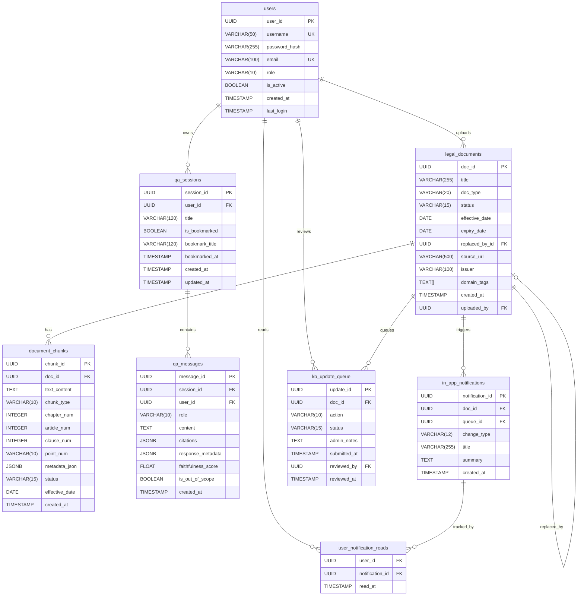

# Thiết Kế Cơ Sở Dữ Liệu PostgreSQL
## AI Trợ Lý Tra Cứu & Tuân Thủ Quy Định Giao Thông Vận Tải

| Mục | Nội dung |
|---|---|
| **Database Engine** | PostgreSQL 16+ |
| **ORM** | SQLAlchemy 2.0 (async) |
| **Migration Tool** | Alembic |
| **Encoding** | UTF-8 |
| **Collation** | `vi_VN.UTF-8` hoặc `und-x-icu` (Unicode) |
| **Ngày tạo** | 10/06/2026 |

---

## Mục lục

1. [Sơ đồ ERD (Entity Relationship Diagram)](#1-sơ-đồ-erd)
2. [SQL DDL - Tạo các bảng](#2-sql-ddl---tạo-các-bảng)
3. [Index Strategy](#3-index-strategy)
4. [Seed Data mẫu](#4-seed-data-mẫu)
5. [Alembic Migration Setup](#5-alembic-migration-setup)

---

## 1. Sơ đồ ERD



---

## 2. SQL DDL - Tạo các bảng

### 2.1 Extensions & Setup

```sql
-- Bật UUID generation
CREATE EXTENSION IF NOT EXISTS "pgcrypto";

-- Bật pgvector cho Vector Search
CREATE EXTENSION IF NOT EXISTS vector;

-- Bật Full-Text Search tiếng Việt (dự phòng BM25)
CREATE EXTENSION IF NOT EXISTS "pg_trgm";

-- Schema version tracking (Alembic)
CREATE TABLE IF NOT EXISTS alembic_version (
    version_num VARCHAR(32) NOT NULL,
    CONSTRAINT alembic_version_pkc PRIMARY KEY (version_num)
);
```

---

### 2.2 Bảng `users`

```sql
CREATE TABLE users (
    user_id         UUID            PRIMARY KEY DEFAULT gen_random_uuid(),
    username        VARCHAR(50)     UNIQUE,
    password_hash   VARCHAR(255)    NOT NULL,
    email           VARCHAR(100)    NOT NULL UNIQUE,
    role            VARCHAR(10)     NOT NULL DEFAULT 'USER'
                        CHECK (role IN ('USER', 'ADMIN')),
    is_active       BOOLEAN         NOT NULL DEFAULT TRUE,
    created_at      TIMESTAMP WITH TIME ZONE NOT NULL DEFAULT NOW(),
    last_login_at   TIMESTAMP WITH TIME ZONE
);

COMMENT ON TABLE  users               IS 'Tài khoản người dùng và phân quyền hệ thống';
COMMENT ON COLUMN users.user_id       IS 'ID duy nhất dạng UUIDv4';
COMMENT ON COLUMN users.role          IS 'USER: người tra cứu luật; ADMIN: quản trị viên hệ thống';
COMMENT ON COLUMN users.password_hash IS 'Mật khẩu đã mã hóa bằng bcrypt (cost=12)';
```

---

### 2.3 Bảng `legal_documents`

```sql
CREATE TABLE legal_documents (
    doc_id          UUID            PRIMARY KEY DEFAULT gen_random_uuid(),
    title           VARCHAR(255)    NOT NULL,
    doc_type        VARCHAR(20)     NOT NULL
                        CHECK (doc_type IN ('LUAT', 'NGHI_DINH', 'THONG_TU', 'QUYET_DINH', 'CONG_VAN')),
    status          VARCHAR(15)     NOT NULL DEFAULT 'active'
                        CHECK (status IN ('active', 'repealed', 'pending_review')),
    effective_date  DATE            NOT NULL,
    expiry_date     DATE,
    replaced_by_id  UUID            REFERENCES legal_documents(doc_id) ON DELETE SET NULL,
    source_url      VARCHAR(500),
    issuer          VARCHAR(100)    NOT NULL,
    domain_tags     TEXT[]          NOT NULL DEFAULT '{}',
    uploaded_by     UUID            NOT NULL REFERENCES users(user_id) ON DELETE RESTRICT,
    created_at      TIMESTAMP WITH TIME ZONE NOT NULL DEFAULT NOW(),

    CONSTRAINT chk_expiry_after_effective
        CHECK (expiry_date IS NULL OR expiry_date > effective_date)
);

COMMENT ON TABLE  legal_documents                IS 'Văn bản pháp luật gốc được ADMIN tải lên';
COMMENT ON COLUMN legal_documents.doc_type       IS 'Phân loại: Luật, Nghị định, Thông tư, Quyết định, Công văn';
COMMENT ON COLUMN legal_documents.status         IS 'active=còn hiệu lực; repealed=hết hiệu lực; pending_review=chờ duyệt';
COMMENT ON COLUMN legal_documents.replaced_by_id IS 'FK tự tham chiếu: văn bản nào thay thế văn bản này';
COMMENT ON COLUMN legal_documents.domain_tags    IS 'Mảng nhãn chủ đề: {xe_may, xe_tai, taxi, van_tai_hanh_khach}';
```

---

### 2.4 Bảng `document_chunks`

```sql
CREATE TABLE document_chunks (
    chunk_id        UUID            PRIMARY KEY DEFAULT gen_random_uuid(),
    doc_id          UUID            NOT NULL REFERENCES legal_documents(doc_id) ON DELETE CASCADE,
    text_content    TEXT            NOT NULL,
    chunk_type      VARCHAR(10)     NOT NULL
                        CHECK (chunk_type IN ('chuong', 'dieu', 'khoan', 'diem', 'phu_luc')),
    chapter_num     INTEGER,
    article_num     INTEGER,
    clause_num      INTEGER,
    point_num       VARCHAR(10),
    -- Metadata denormalized từ legal_documents (tối ưu truy vấn)
    status          VARCHAR(15)     NOT NULL DEFAULT 'active',
    effective_date  DATE            NOT NULL,
    metadata_json   JSONB           NOT NULL DEFAULT '{}',
    -- Vector Embeddings lưu trực tiếp bằng pgvector
    embedding_vector vector(1536),
    -- Full-text search
    text_tsv        TSVECTOR        GENERATED ALWAYS AS (
                        to_tsvector('simple', text_content)
                    ) STORED,
    created_at      TIMESTAMP WITH TIME ZONE NOT NULL DEFAULT NOW(),

    CONSTRAINT chk_chunk_hierarchy
        CHECK (
            (chunk_type = 'chuong' AND chapter_num IS NOT NULL) OR
            (chunk_type IN ('dieu', 'khoan', 'diem') AND article_num IS NOT NULL) OR
            (chunk_type IN ('phu_luc'))
        )
);

COMMENT ON TABLE  document_chunks              IS 'Đoạn văn bản đã được chunking theo cấu trúc pháp lý Chương/Điều/Khoản/Điểm';
COMMENT ON COLUMN document_chunks.chunk_type   IS 'Cấp độ phân cấp: chuong > dieu > khoan > diem';
COMMENT ON COLUMN document_chunks.metadata_json IS 'Metadata JSON bổ sung: {"replaced_by": "uuid", "conflict_ids": [...]}';
COMMENT ON COLUMN document_chunks.embedding_vector IS 'Vector embedding lưu bằng pgvector, số chiều 1536 (OpenAI text-embedding-3-small)';
COMMENT ON COLUMN document_chunks.text_tsv     IS 'Cột tsvector cho full-text search (PostgreSQL FTS)';
COMMENT ON COLUMN document_chunks.status       IS 'Denormalized từ legal_documents.status để tối ưu query';
```

---

### 2.5 Bảng `qa_sessions`

```sql
CREATE TABLE qa_sessions (
    session_id      UUID            PRIMARY KEY,
    user_id         UUID            NOT NULL REFERENCES users(user_id) ON DELETE CASCADE,
    title           VARCHAR(120)    NOT NULL,
    is_bookmarked   BOOLEAN         NOT NULL DEFAULT FALSE,
    bookmark_title  VARCHAR(120),
    bookmarked_at   TIMESTAMP WITH TIME ZONE,
    created_at      TIMESTAMP WITH TIME ZONE NOT NULL DEFAULT NOW(),
    updated_at      TIMESTAMP WITH TIME ZONE NOT NULL DEFAULT NOW(),

    CONSTRAINT uq_qa_sessions_session_user UNIQUE (session_id, user_id)
);

COMMENT ON TABLE  qa_sessions          IS 'Nhóm các tin nhắn trong một phiên hội thoại của người dùng';
COMMENT ON COLUMN qa_sessions.title    IS 'Tiêu đề tự động sinh từ câu hỏi đầu tiên trong phiên';
COMMENT ON COLUMN qa_sessions.bookmark_title IS 'Tên do USER đặt khi lưu cuộc trò chuyện vào mục Đã lưu';
COMMENT ON COLUMN qa_sessions.updated_at IS 'Cập nhật mỗi khi có tin nhắn mới trong phiên';
```

---

### 2.6 Bảng `qa_messages`

```sql
CREATE TABLE qa_messages (
    message_id          UUID        PRIMARY KEY DEFAULT gen_random_uuid(),
    session_id          UUID        NOT NULL,
    user_id             UUID        NOT NULL REFERENCES users(user_id) ON DELETE CASCADE,
    role                VARCHAR(12) NOT NULL CHECK (role IN ('user', 'assistant')),
    content             TEXT        NOT NULL,
    citations           JSONB       NOT NULL DEFAULT '[]',
    response_metadata   JSONB       NOT NULL DEFAULT '{}',
    faithfulness_score  FLOAT,
    is_out_of_scope     BOOLEAN     NOT NULL DEFAULT FALSE,
    created_at          TIMESTAMP WITH TIME ZONE NOT NULL DEFAULT NOW(),

    CONSTRAINT fk_qa_messages_session_user
        FOREIGN KEY (session_id, user_id)
        REFERENCES qa_sessions(session_id, user_id)
        ON DELETE CASCADE
);

COMMENT ON TABLE  qa_messages                   IS 'Chi tiết từng tin nhắn trong phiên Q&A, lưu trữ để audit và evaluation';
COMMENT ON COLUMN qa_messages.citations         IS 'JSON array: [{"chunk_id": "uuid", "doc_title": "...", "article_num": 9, "text_snippet": "..."}]';
COMMENT ON COLUMN qa_messages.response_metadata IS 'Metadata ổn định của câu trả lời chat: risk_level, answer_mode, confidence, provision_citations, document_sources, historical_references và clarification_question';
COMMENT ON COLUMN qa_messages.faithfulness_score IS 'Điểm RAGAS Faithfulness (0-1); NULL nếu chưa chạy evaluation';
COMMENT ON COLUMN qa_messages.is_out_of_scope   IS 'TRUE nếu câu hỏi bị deflect vì ngoài phạm vi luật GTVT';
```

---

### 2.7 Bookmark cuộc trò chuyện

MVP hiện tại không dùng bảng `bookmarks` riêng. Trạng thái lưu cuộc trò chuyện nằm trực tiếp trên `qa_sessions` bằng các cột `is_bookmarked`, `bookmark_title`, `bookmarked_at`. Cách này giữ mục `Đã lưu` tập trung vào toàn bộ phiên hỏi đáp, tránh trộn lẫn bookmark văn bản/citation khi chưa có UX hoàn chỉnh cho các loại nội dung đó.

---

### 2.8 Bảng `in_app_notifications`

```sql
CREATE TABLE in_app_notifications (
    notification_id UUID            PRIMARY KEY DEFAULT gen_random_uuid(),
    doc_id          UUID            NOT NULL REFERENCES legal_documents(doc_id) ON DELETE CASCADE,
    queue_id        UUID            REFERENCES kb_update_queue(queue_id) ON DELETE SET NULL,
    change_type     VARCHAR(12)     NOT NULL,
    title           VARCHAR(255)    NOT NULL,
    summary         TEXT            NOT NULL,
    created_at      TIMESTAMP WITH TIME ZONE NOT NULL DEFAULT NOW()
);

COMMENT ON TABLE  in_app_notifications        IS 'Thông báo in-app gửi đến USER khi ADMIN xuất bản thay đổi KB';
COMMENT ON COLUMN in_app_notifications.queue_id IS 'Hồ sơ HITL đã tạo thông báo; giữ NULL nếu queue bị xóa';
COMMENT ON COLUMN in_app_notifications.change_type IS 'create/update/repeal theo hồ sơ KB được duyệt';
COMMENT ON COLUMN in_app_notifications.summary IS 'Tóm tắt ngắn hiển thị trong trung tâm thông báo';
```

---

### 2.9 Bảng `user_notification_reads`

```sql
CREATE TABLE user_notification_reads (
    user_id         UUID    NOT NULL REFERENCES users(user_id) ON DELETE CASCADE,
    notification_id UUID    NOT NULL REFERENCES in_app_notifications(notification_id) ON DELETE CASCADE,
    read_at         TIMESTAMP WITH TIME ZONE NOT NULL DEFAULT NOW(),

    PRIMARY KEY (user_id, notification_id)
);

COMMENT ON TABLE user_notification_reads IS 'Tracking trạng thái đọc thông báo của từng người dùng (nhiều-nhiều)';
```

---

### 2.10 Bảng `document_lifecycle_events`

```sql
CREATE TABLE document_lifecycle_events (
    event_id              UUID PRIMARY KEY DEFAULT gen_random_uuid(),
    doc_id                UUID NOT NULL REFERENCES legal_documents(doc_id) ON DELETE CASCADE,
    event_type            VARCHAR(32) NOT NULL,
    source                VARCHAR(32) NOT NULL,
    effective_on          DATE NOT NULL,
    previous_status       VARCHAR(24) NOT NULL,
    previous_legal_status VARCHAR(24) NOT NULL,
    new_status            VARCHAR(24) NOT NULL,
    new_legal_status      VARCHAR(24) NOT NULL,
    details               JSONB NOT NULL DEFAULT '{}',
    created_at            TIMESTAMP WITH TIME ZONE NOT NULL DEFAULT NOW()
);
```

Bảng lưu audit cho hồ sơ repeal được duyệt, lịch hết hiệu lực tương lai và backfill/scheduler. Nó không thay thế `kb_update_queue`; queue lưu quyết định của reviewer, còn lifecycle event lưu thời điểm trạng thái thực tế được chuyển.

---

### 2.11 Bảng `kb_update_queue`

> Cập nhật implementation hiện tại (Alembic `0002_kb_update_queue`): tên cột và trạng thái đã được mở rộng để phục vụ workflow upload → review queue → publish. Trường `source_path` chỉ được backend sử dụng để phục vụ file nguồn nội bộ; API trả về cho frontend không còn lộ đường dẫn này.

```sql
CREATE TABLE kb_update_queue (
    queue_id        UUID            PRIMARY KEY DEFAULT gen_random_uuid(),
    doc_id          UUID            NOT NULL REFERENCES legal_documents(doc_id) ON DELETE CASCADE,
    target_doc_id   UUID            REFERENCES legal_documents(doc_id) ON DELETE SET NULL,
    change_type     VARCHAR(12)     NOT NULL DEFAULT 'create'
                        CHECK (change_type IN ('create', 'update', 'repeal')),
    review_status   VARCHAR(16)     NOT NULL DEFAULT 'pending'
                        CHECK (review_status IN ('pending', 'approved', 'rejected')),
    processing_status VARCHAR(16)   NOT NULL DEFAULT 'ready'
                        CHECK (processing_status IN ('queued', 'ready', 'failed')),
    source_file_name VARCHAR(255),
    source_path     VARCHAR(500),
    parser_confidence FLOAT,
    warning_messages TEXT[]         NOT NULL DEFAULT '{}',
    extracted_metadata JSONB        NOT NULL DEFAULT '{}',
    review_checklist JSONB          NOT NULL DEFAULT '{}',
    reviewer_draft_note TEXT,
    reviewer_note   TEXT,
    reject_reason   VARCHAR(40),
    processing_error TEXT,
    created_by      UUID,
    reviewed_by     UUID,
    reviewed_at     TIMESTAMP WITH TIME ZONE,
    created_at      TIMESTAMP WITH TIME ZONE NOT NULL DEFAULT NOW(),
    updated_at      TIMESTAMP WITH TIME ZONE NOT NULL DEFAULT NOW()
);

COMMENT ON TABLE  kb_update_queue                    IS 'Hàng đợi HITL cho mọi thay đổi KB trước khi publish active.';
COMMENT ON COLUMN kb_update_queue.change_type        IS 'create=thêm mới; update=cập nhật; repeal=đánh dấu hết hiệu lực';
COMMENT ON COLUMN kb_update_queue.review_status      IS 'pending/approved/rejected do reviewer quyết định';
COMMENT ON COLUMN kb_update_queue.processing_status  IS 'queued/ready/failed cho parse-chunk trước khi reviewer xét';
COMMENT ON COLUMN kb_update_queue.extracted_metadata IS 'Preview text, chunk_count và metadata parser trích xuất được';
COMMENT ON COLUMN kb_update_queue.review_checklist   IS 'Checklist reviewer phải hoàn tất trước khi approve';
```

---

### 2.12 AI quality operations (Alembic `0007` + `0008`)

| Bảng | Vai trò | Trường trọng yếu |
|---|---|---|
| `quality_observations` | Một observation cho mỗi chat request; lưu query/response đã khử PII, pipeline snapshot và kết quả guardrail. | `trace_id`, `status`, `citations`, `evidence`, `pipeline_metadata`, `faithfulness_score`, `first_token_latency_ms`, `latency_ms` |
| `quality_issues` | Hàng đợi điều tra có bằng chứng và audit review. | `issue_type`, `severity`, `status`, `machine_reason`, `evidence`, `reviewer_conclusion`, `root_cause`, `reviewed_by` |
| `quality_release_checks` | Snapshot bất biến của một lần chạy release gate. | `status`, `dataset_version`, `config`, `metrics`, coverage counters, `gate_failures` |
| `quality_release_cases` | Chẩn đoán từng golden case thuộc một release check. | `run_id`, `case_id`, `category`, `status`, metric và `details` |

`quality_issues.trace_id` cascade theo observation; `reviewed_by` và observation
`user_id` dùng `ON DELETE SET NULL` để giữ audit. Dữ liệu gửi ra telemetry ngoài
hệ thống được mask tại export; dashboard vận hành đọc trực tiếp các bảng trên.

Index chính: observation theo `created_at`, `status`, `faithfulness_score`; issue
theo `(status, severity, created_at)` và `trace_id`; release check theo
`generated_at`, `status`; release case theo `(run_id, status)`.

---

## 3. Index Strategy

```sql
-- ============================================================
-- USERS
-- ============================================================
CREATE INDEX idx_users_role        ON users(role);
CREATE INDEX idx_users_is_active   ON users(is_active);
CREATE INDEX idx_users_email       ON users(email);

-- ============================================================
-- LEGAL_DOCUMENTS
-- ============================================================
-- Index chính cho metadata filtering
CREATE INDEX idx_legal_docs_status          ON legal_documents(status);
CREATE INDEX idx_legal_docs_doc_type        ON legal_documents(doc_type);
CREATE INDEX idx_legal_docs_effective_date  ON legal_documents(effective_date);
-- GIN index cho array domain_tags
CREATE INDEX idx_legal_docs_domain_tags     ON legal_documents USING GIN(domain_tags);
-- Partial index: chỉ lấy văn bản còn hiệu lực (query phổ biến nhất)
CREATE INDEX idx_legal_docs_active          ON legal_documents(effective_date)
    WHERE status = 'active';
-- FK tự tham chiếu: tra văn bản thay thế (validity_checker khi cảnh báo repealed)
CREATE INDEX idx_legal_docs_replaced_by     ON legal_documents(replaced_by_id);
-- Chặn upload trùng file nguồn ở tầng DB, bỏ qua bản ghi chưa có checksum
CREATE UNIQUE INDEX uq_legal_docs_source_checksum
    ON legal_documents(source_checksum)
    WHERE source_checksum IS NOT NULL;

-- ============================================================
-- DOCUMENT_CHUNKS
-- ============================================================
-- Index chính: lọc theo status + doc_id (retrieval)
CREATE INDEX idx_chunks_doc_id              ON document_chunks(doc_id);
CREATE INDEX idx_chunks_status              ON document_chunks(status);
CREATE INDEX idx_chunks_article             ON document_chunks(doc_id, article_num, clause_num);
-- GIN index cho JSONB metadata
CREATE INDEX idx_chunks_metadata            ON document_chunks USING GIN(metadata_json);
-- HNSW index cho Vector Search (pgvector)
CREATE INDEX idx_chunks_embedding           ON document_chunks USING hnsw (embedding_vector vector_cosine_ops);
-- GIN index cho full-text search (BM25 fallback)
CREATE INDEX idx_chunks_fts                 ON document_chunks USING GIN(text_tsv);
-- Partial index: chỉ chunks đang active (giảm kích thước index scan)
CREATE INDEX idx_chunks_active              ON document_chunks(doc_id, chunk_type)
    WHERE status = 'active';

-- ============================================================
-- QA_SESSIONS & QA_MESSAGES
-- ============================================================
CREATE INDEX idx_qa_sessions_user_updated   ON qa_sessions(user_id, updated_at);
CREATE INDEX idx_qa_sessions_user_created   ON qa_sessions(user_id, created_at);
CREATE INDEX idx_qa_sessions_user_bookmarked ON qa_sessions(user_id, is_bookmarked, bookmarked_at);
CREATE INDEX idx_qa_messages_session_created ON qa_messages(session_id, created_at);
CREATE INDEX idx_qa_messages_user_created   ON qa_messages(user_id, created_at);

-- ============================================================
-- BOOKMARKS
-- ============================================================

-- ============================================================
-- NOTIFICATIONS
-- ============================================================
CREATE INDEX idx_notifications_created_at   ON in_app_notifications(created_at DESC);
CREATE INDEX idx_notifications_doc_created  ON in_app_notifications(doc_id, created_at);
CREATE INDEX idx_notif_reads_user           ON user_notification_reads(user_id);
CREATE INDEX idx_lifecycle_events_doc_created ON document_lifecycle_events(doc_id, created_at);
CREATE INDEX idx_lifecycle_events_effective_on ON document_lifecycle_events(effective_on);

-- ============================================================
-- KB_UPDATE_QUEUE
-- ============================================================
CREATE INDEX idx_kb_queue_doc_id            ON kb_update_queue(doc_id);
CREATE INDEX idx_kb_queue_target_doc_id     ON kb_update_queue(target_doc_id);
CREATE INDEX idx_kb_queue_review_status     ON kb_update_queue(review_status);
CREATE INDEX idx_kb_queue_processing_status ON kb_update_queue(processing_status);
CREATE INDEX idx_kb_queue_created_at        ON kb_update_queue(created_at);
```

---

## 4. Schema hiện hành đến Alembic `0015`

Migration `0003_corpus_lifecycle_assets` mở rộng schema nền ở trên. Migration `0009_chat_session_bookmarks` bổ sung bookmark hội thoại trên `qa_sessions`; migration `0010_notifications_rate_limit` bổ sung `in_app_notifications` và `user_notification_reads`; migration `0011_document_lifecycle_events` bổ sung audit vòng đời; migration `0012_chat_owner_constraints` bổ sung unique `(session_id, user_id)` và composite FK từ `qa_messages` sang `qa_sessions` để message không thể lệch owner session. Migration `0015_chat_response_metadata` bổ sung `qa_messages.response_metadata` để khi người dùng mở lại lịch sử chat, UI vẫn phân biệt được risk/mode/căn cứ hiện hành/nguồn tổng quan/tham chiếu lịch sử. Khi có khác
biệt, model SQLAlchemy và chuỗi migration Alembic là định nghĩa thực thi hiện hành.

### 4.1 Lifecycle và phạm vi RAG

`legal_documents` tách riêng:

- review: `review_status`;
- hiệu lực pháp lý: `legal_status`, `valid_from`, `valid_to`;
- phạm vi retrieval: `document_family` (corpus), `rag_scope`, `rag_enabled`;
- khả năng tái lập: `source_checksum`, `source_version`, `parser_profile`,
  `parser_version`, `index_version`.

`document_chunks` sao chép các bộ lọc bắt buộc xuống chunk và bổ sung
`provision_status`, `canonical_provision_id`, `content_hash`, phiên bản embedding,
locator generic (`locator_type`, `locator_label`, `section_path`,
`section_number`, `sign_codes`, `figure_ids`, `table_id`, `asset_ids`).
`locator_label` là nhãn hiển thị ngắn; với QCVN có nhiều mã biển, danh sách đầy
đủ nằm ở `sign_codes`/`metadata_json.sign_codes` để không vượt giới hạn varchar
của locator.

### 4.2 Quan hệ, asset và catalog biển báo

- `document_relations`: lưu quan hệ `promulgates`, `amends`, `replaces`,
  `partially_repeals`, `fully_repeals`, `implements`, `attachment_of`.
- `document_assets`: lưu metadata và storage key của source/ảnh, checksum,
  mapping confidence và trạng thái publish; asset chưa approved không được public.
- `traffic_signs`: catalog text đã review, liên kết source chunk và primary asset;
  chỉ record active + approved + đúng khoảng hiệu lực mới được API trả ra.

Các index `idx_legal_docs_searchable`, `idx_chunks_searchable`,
`idx_chunks_sign_codes`, trigram số hiệu/tên biển và unique normalized sign code
phục vụ exact lookup, active filter và retrieval theo corpus.

### 4.3 Foundation schema cho kho văn bản hiện hành

Alembic `0013_kb_v2_foundation` thêm nhánh bảng với tiền tố `kb_v2_`. Sau cutover, các bảng này là schema vận hành hiện hành của kho văn bản. Tiền tố `kb_v2_` chỉ là chi tiết kỹ thuật nội bộ để tránh migration đổi tên lớn; không phải nhãn sản phẩm hiển thị trên UI.

| Bảng | Vai trò |
|---|---|
| `kb_v2_legal_documents` | Danh tính logic của văn bản hiện hành |
| `kb_v2_document_revisions` | Revision upload/parse/review bất biến |
| `kb_v2_source_assets` | File nguồn, asset và rendition lưu ở local/object storage |
| `kb_v2_canonical_nodes` | Cây cấu trúc đã parse: article/clause/table/form/appendix/image caption |
| `kb_v2_retrieval_units` | Đơn vị answerable/searchable với embedding riêng |
| `kb_v2_document_relations` | Quan hệ pháp lý giữa các văn bản |
| `kb_v2_metadata_proposals` | Proposal metadata có review status và provenance |
| `kb_v2_canonical_provisions` | Định danh provision logic |
| `kb_v2_provision_versions` | Nội dung provision theo mốc hiệu lực |
| `kb_v2_provision_sources` | Trace từ provision version về canonical node |
| `kb_v2_amendment_operations` | Các thao tác sửa đổi theo provision |
| `kb_v2_standard_summaries` | Summary chuẩn cần reviewer duyệt |
| `kb_v2_review_events` | Audit trail cho review/publish/suspend |

Các constraint chính của foundation schema:

- Revision tách ba lớp trạng thái: `ingestion_status`, `review_status`, `publication_status`.
- Retrieval và provision version dùng `answerable_status` để phục vụ fail-closed trước khi đưa vào retrieval thực tế.
- `kb_v2_document_revisions` unique theo `(document_id, revision_number)`.
- `kb_v2_retrieval_units` unique theo `content_hash`; hash này được sinh theo document + canonical node + citation/text để tránh va chạm khi nhiều khoản khác nhau có cùng câu chữ hoặc cùng nhãn ngắn.
- Source asset có `storage_uri` unique để hỗ trợ provenance/audit object storage.
- `kb_v2_metadata_proposals` có `source_type IN ('upload', 'parser', 'ai', 'admin')` và `review_status IN ('needs_review', 'approved', 'rejected')`.

Ghi chú runtime hiện hành:

- `kb_v2_legal_documents`: có thêm `metadata_json` để giữ metadata canonical ngoài các cột chuẩn, ví dụ `document_role`.
- `kb_v2_document_revisions`: giữ revision draft/published/suspended và checksum/parser metadata.
- `kb_v2_source_assets`: lưu source asset cùng storage backend provenance.
- `kb_v2_canonical_nodes`: từng node được review riêng trước publish.
- `kb_v2_metadata_proposals`: seed từ upload form và có thể thêm proposal admin thủ công.
- `kb_v2_document_relations`: relation proposal/review giữa các văn bản; review status hiện nằm trong `metadata_json`.
- `kb_v2_standard_summaries`: summary proposal của revision, phải được admin approve trước publish.
- `kb_v2_retrieval_units`: chỉ được tạo tại bước publish, sau khi revision pass publish gates.
- `kb_v2_review_events`: audit trail cho created/updated/approved/rejected/published/suspended.

Quy tắc dữ liệu public/chat:

- Public documents chỉ đọc từ revision `published`.
- Văn bản có `legal_status='suspended'` không xuất hiện ở public surface.
- Chatbot không được dùng retrieval units của văn bản `suspended`.
- Historical citation có thể đọc metadata/source lịch sử để giữ provenance, nhưng không làm thay đổi tập dữ liệu đủ điều kiện cho public/chat.

---

## 5. Seed Data mẫu

```sql
-- ============================================================
-- Tài khoản Admin mặc định (đổi mật khẩu ngay sau deploy!)
-- ============================================================
INSERT INTO users (username, password_hash, email, role) VALUES
(
    'admin',
    '$2b$12$placeholder_bcrypt_hash_change_immediately',
    'admin@gtvt.vn',
    'ADMIN'
);

-- ============================================================
-- Văn bản luật mẫu (để test pipeline)
-- ============================================================
INSERT INTO legal_documents (
    title, doc_type, status, effective_date, issuer, source_url, uploaded_by
)
SELECT
    'Nghị định 336/2025/NĐ-CP về xử phạt vi phạm hành chính trong lĩnh vực giao thông đường bộ',
    'NGHI_DINH',
    'active',
    '2026-03-01',
    'Chính phủ',
    'https://vbpl.vn/TW/Pages/vbpq-toanvan.aspx?ItemID=placeholder',
    u.user_id
FROM users u WHERE u.username = 'admin';
```

---

*Tài liệu này là Single Source of Truth cho thiết kế database — mọi thay đổi schema phải được cập nhật ở đây trước khi viết code.*

