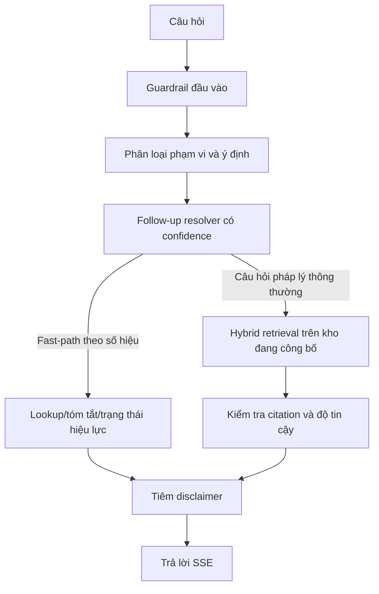

# Tổng Quan RAG
## AI Trợ Lý Tra Cứu & Tuân Thủ Quy Định Giao Thông Vận Tải

| Mục | Nội dung |
|---|---|
| Embedding | `text-embedding-3-small` |
| Agent orchestration | LangGraph |
| Retrieval runtime hiện hành | `kb_v2` published-only |
| Cập nhật gần nhất | 09/07/2026 |

---

## 1. Mục tiêu

RAG pipeline phục vụ tra cứu quy định giao thông vận tải bằng tiếng Việt, với ba nguyên tắc bất biến:

- Chỉ dùng căn cứ đang công bố và hợp lệ cho public/chat.
- Mọi kết luận pháp lý phải có citation hoặc phải từ chối vì thiếu căn cứ.
- Mọi câu trả lời pháp lý phải có disclaimer.

---

## 2. Luồng tổng quát

---

## 3. Nguồn dữ liệu runtime

### 3.1 Public/chat

- Chỉ đọc từ nhánh dữ liệu `kb_v2_*` đã công bố.
- Chỉ xét revision `published` và nội dung đã duyệt.
- Loại trừ văn bản `suspended` khỏi public list và khỏi chatbot.
- Không còn fallback runtime sang `legal_documents` hoặc `document_chunks`.

### 3.2 Admin

- Màn `Duyệt văn bản` thao tác trên revision upload/review/publish.
- Màn `Kho văn bản` thao tác trên inventory văn bản đã hoặc từng công bố.
- Prefix `/api/v1/admin/kb-v2` vẫn được giữ để tương thích contract nội bộ, nhưng UI phải dùng nhãn trung lập `Kho văn bản`.

---

## 4. Fast-path theo ý định

Runtime có các nhánh deterministic trước khi chạy retrieval toàn kho:

| Ý định | Hành vi |
|---|---|
| `document_summary_standard` | Trả tóm tắt chuẩn đã duyệt nếu văn bản đang công bố có summary |
| `document_lookup` | Trả metadata/tổng quan theo đúng số hiệu văn bản đang công bố |
| `effective_status` | Trả trạng thái hiệu lực của văn bản đang công bố |
| `ambiguous` | Hỏi lại ngắn gọn, không retrieval |

Nếu người dùng nêu rõ số hiệu nhưng kho hiện hành không có văn bản đó, hệ thống trả lời ngắn gọn là chưa tìm thấy trong kho hiện tại và không semantic-fallback sang văn bản gần nghĩa.

---

## 5. Hybrid retrieval hiện hành

- Trước khi vào retrieval, follow-up resolver chỉ dùng `conversation_context` để hiểu topic khi câu hiện tại thật sự phụ thuộc ngữ cảnh.
- Nếu confidence của resolver thấp, runtime trả yêu cầu làm rõ thay vì ghép query heuristic.
- History không được dùng như evidence pháp lý và không override input guardrail hiện có.
- Exact lookup, FTS và vector search đều chạy trên tập dữ liệu đang công bố.
- Query có số hiệu văn bản sẽ được ép phạm vi về đúng `document_id` tương ứng nếu tìm thấy.
- `hybrid_v2` là nhánh retrieval runtime đang hoạt động.
- `src.rag.retrieval.hybrid` chỉ còn là mã legacy để bảo trì, không được import vào đường chạy chính.
- Sau local reranker, evidence policy gom candidate theo document để quyết định:
  - query tổng quát: trình bày vai trò bổ sung theo thứ tự `Luat -> Nghi dinh -> Thong tu`
  - query cụ thể về mức phạt: ưu tiên văn bản có căn cứ trực tiếp cho con số xử phạt, thường là nghị định
  - near-tie khác hướng: rơi về `clarification_needed`, `multiple_possibilities` hoặc `insufficient_evidence`

Điều kiện dữ liệu đủ điều kiện trả lời:

- revision `published`
- document không `suspended`
- retrieval unit không `suspended` và không `not_answerable`
- nếu có `query_date`, evidence phải hợp lệ theo mốc thời gian đó

---

## 6. Citation, faithfulness và fail-closed

- Mọi câu trả lời pháp lý phải đi qua lớp xác minh citation.
- Nếu không còn citation hợp lệ, thiếu căn cứ hoặc faithfulness dưới ngưỡng an toàn, hệ thống trả template thiếu căn cứ thay vì suy diễn.
- Historical citation được giữ để người dùng mở lại nguồn của câu trả lời cũ, kể cả khi revision sau đó bị `suspended` hoặc `archived`.
- Trước khi serialize response, backend còn gán metadata policy deterministic:
  - `answer_mode` để phân biệt direct, summary, historical, clarification, insufficient, out-of-scope hoặc strategy/fact-dependent
  - `risk_level` để UI/audit biết mức nhạy cảm của câu trả lời mà không đưa risk này vào answer text
- Boundary legal advice được áp dụng riêng:
  - procedure/objective checklist vẫn là giá trị sản phẩm và tiếp tục đi qua retrieval/citation bình thường
  - strategy cá nhân hóa như kiện hay không, thương lượng thế nào, làm sao tránh phạt sẽ bị redirect sang quy định/thủ tục khách quan thay vì cho lời khuyên
- Prompt không được tự suy luận một "van ban chinh" khi evidence policy chưa chốt; nếu nhiều văn bản chỉ mang tính bổ sung thì response mô tả vai trò của từng văn bản thay vì ép một nguồn duy nhất.
- Taxonomy citation/nguồn được tách như sau:
  - `provision_citations`: chỉ cho căn cứ active, đã verify/partial
  - `document_sources`: nguồn văn bản tổng quan cho summary, lookup và effective-status
  - `historical_references`: chỗ dành riêng cho tham chiếu lịch sử, không trộn vào căn cứ hiện hành

---

## 7. Quan hệ với public documents

- `GET /api/v1/documents` và chatbot dùng chung khái niệm “văn bản đang công bố”.
- Văn bản tạm ngừng không hiện ở public surface và không được dùng cho chatbot.
- Public source/historical citation source luôn có cảnh báo đối chiếu nguồn chính thức.

---

## 8. Thành phần liên quan

| Tài liệu | Mục đích |
|---|---|
| [10-rag-chunking-spec.md](10-rag-chunking-spec.md) | Parse và cấu trúc nguồn |
| [11-rag-retrieval-ranking-spec.md](11-rag-retrieval-ranking-spec.md) | Retrieval, ranking, gating |
| [12-citation-verification-spec.md](12-citation-verification-spec.md) | Xác minh citation |
| [13-rag-prompt-guardrail-spec.md](13-rag-prompt-guardrail-spec.md) | Prompt, guardrail, disclaimer |
| [14-rag-evaluation-dataset.md](14-rag-evaluation-dataset.md) | Eval và release gate |

Tài liệu này mô tả trạng thái triển khai hiện hành, không mô tả mô hình chuyển tiếp đã kết thúc.

## 10. Query policy source of truth

- Deterministic pre-retrieval text policy is versioned in `app/backend/src/rag/policies/query_policy.json`.
- `src.rag.query_policy` loads and validates the config for:
  - intent hints
  - follow-up resolver patterns
  - legal-advice boundary patterns
  - retrieval expansion rules

## 11. Eval-backed runtime coverage

Release eval hien tai khong chi cham citation chung, ma con khoa cac branch chat runtime da co:

- direct legal answer voi `provision_citations`
- summary/document lookup voi `document_sources`
- historical/lifecycle voi `historical_references`
- follow-up resolver dung history khi du ro va hoi lai khi confidence thap
- evidence policy near-tie -> `clarification_needed` / `multiple_possibilities` / `insufficient_evidence`
- legal-advice boundary va prompt-injection redirect
