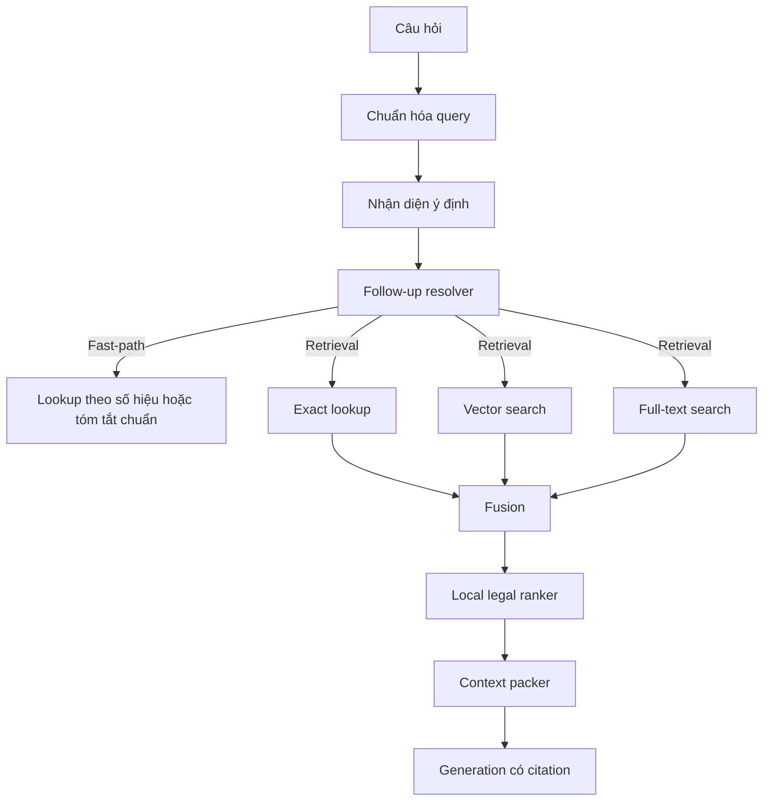

# Đặc Tả Retrieval Và Xếp Hạng
## AI Trợ Lý Tra Cứu & Tuân Thủ Quy Định Giao Thông Vận Tải

| Mục | Nội dung |
|---|---|
| Retrieval runtime | `src.rag.retrieval.hybrid_v2` |
| Embedding | `text-embedding-3-small` |
| Mục tiêu | Citation đúng, fail-closed, không dùng dữ liệu legacy |
| Cập nhật gần nhất | 09/07/2026 |

---

## 1. Nguyên tắc bất biến

- Public/chat chỉ retrieval trên kho văn bản đang công bố với `legal_status='active'`.
- Không fallback runtime sang `LegalDocument` hoặc `document_chunks`.
- Văn bản `suspended`, `expired`, `replaced` hoặc `annulled` không được dùng cho public/chat.
- Nếu người dùng hỏi đúng số hiệu mà kho hiện hành không có, không semantic-fallback sang văn bản gần nghĩa.

---

## 2. Pipeline truy vấn

---

## 3. Eligibility filter bắt buộc

Mọi nhánh exact, vector và FTS chỉ được xét các unit thỏa:

- revision `published`
- document có `legal_status='active'`
- retrieval unit có `answerable_status='active'`
- hợp lệ theo `query_date` nếu câu hỏi có ngữ cảnh thời gian

Public documents và chatbot dùng cùng khái niệm “đang công bố”, nên một văn bản không còn `active` phải đồng thời:

- biến mất khỏi public list
- không còn được retrieval cho chatbot

## 3.1 Follow-up resolver trước retrieval

- Resolver chạy trước exact/vector/FTS để quyết định có nên dùng `conversation_context` hay không.
- Chỉ khi confidence đủ cao, backend mới ghép topic từ history vào `retrieval_query`.
- Nếu câu hiện tại phụ thuộc context nhưng history mơ hồ, runtime trả `query_clarification` thay vì mở rộng query bằng heuristic cũ.
- Resolver chỉ đọc history hội thoại để hiểu topic; history không được coi là evidence pháp lý và không được bỏ qua input guardrail.

---

## 4. Fast-path theo số hiệu

### 4.1 Tóm tắt chuẩn

Nếu câu hỏi là yêu cầu tóm tắt một số hiệu cụ thể:

- có summary chuẩn đã duyệt: trả summary chuẩn
- chưa có summary chuẩn: trả thông báo ngắn gọn là chưa có bản tóm tắt chuẩn

### 4.2 Tra cứu văn bản

Nếu câu hỏi là tra cứu một văn bản cụ thể:

- tìm đúng số hiệu trong kho đang công bố
- trả metadata hoặc trạng thái hiệu lực nếu có
- nếu không có thì trả lời ngắn gọn là chưa tìm thấy trong kho hiện tại

---

## 5. Hybrid retrieval

| Bước | Mô tả |
|---|---|
| Exact lookup | Ưu tiên số hiệu, locator, thuật ngữ pháp lý và tiêu đề văn bản |
| Vector search | So khớp ngữ nghĩa bằng embedding |
| Full-text search | So khớp từ khóa có quote lexeme an toàn |
| Fusion | Hợp nhất kết quả từ ba nhánh |
| Local ranker | Chấm điểm deterministic theo tín hiệu pháp lý |
| Context packer | Chọn số evidence cuối cùng cho prompt |

### 5.1 Exact lookup

- Giữ tiếng Việt có dấu trong query.
- Không bỏ dấu rồi so khớp thô với text gốc.
- Khi query đã xác định số hiệu, exact/vector/FTS phải cùng bị khóa vào đúng văn bản đó.

### 5.2 Full-text search

- Loại token trùng, token vô nghĩa và token dễ trở thành operator.
- Giới hạn số lượng term bằng cấu hình để tránh query quá dài.

### 5.3 Vector search

- Query embedding được normalize whitespace.
- Query embedding bị giới hạn độ dài bằng cấu hình chung để không làm phình request.

---

## 6. Local ranker

### 5.4 Semantic document scope routing

Trước local ranker, runtime có một lớp routing deterministic cho các cụm từ có
tín hiệu mạnh. Mục tiêu là tránh drift giữa các văn bản gần nghĩa và không để
model tự chọn "văn bản chính".

- Cụm về `Luật Đường bộ`, hạ tầng đường bộ, vận tải đường bộ -> `35/2024/QH15`.
- Cụm về `Luật Trật tự, an toàn giao thông đường bộ`, quy tắc giao thông,
  người/phương tiện tham gia giao thông -> `36/2024/QH15`.
- Topic có văn bản nguồn rõ ràng được khóa vào số hiệu tương ứng, ví dụ
  tem/giấy chứng nhận kiểm định -> `16/2021/TT-BGTVT`, sát hạch A1 ->
  `108/2026/TT-BCA`, đăng ký xe -> `79/2024/TT-BCA`, sức khỏe người lái xe ->
  `36/2024/TT-BYT`, kinh doanh vận tải bằng xe ô tô -> `158/2024/ND-CP`.

Rule chỉ kích hoạt khi cụm từ đủ mạnh và không có số hiệu văn bản explicit trong
query. Nếu query đã nêu số hiệu, explicit document lookup luôn ưu tiên.

Local ranker là deterministic và không gọi dịch vụ ngoài. Các tín hiệu chính:

- độ khớp từ khóa
- độ khớp số hiệu văn bản
- độ khớp Điều/Khoản/Điểm
- lexical coverage
- phrase match
- metadata/legal-domain boost

## 6.1 Multi-document evidence policy sau rerank

- Sau khi `rerank_chunks` và `pack_context` chọn candidate cuối, backend còn nhóm evidence theo `doc_id` và `doc_type`.
- Với query tổng quát (`general_legal`, `definition`) và nhiều văn bản bổ sung nhau, prompt notice buộc model trình bày theo vai trò `Luat -> Nghi dinh -> Thong tu`, không tự kết luận một văn bản duy nhất.
- Với query cụ thể về mức phạt, nếu near-tie chỉ là giữa luật khung và nghị định chứa mức phạt, policy buộc model lấy con số từ nghị định có căn cứ trực tiếp thay vì suy từ văn bản cấp cao hơn.
- Nếu nhiều văn bản near-tie nhưng trỏ đến các locator/trường hợp khác nhau:
  - câu quá ngắn hoặc thiếu dữ kiện nhận diện sẽ rơi về `evidence_clarification`
  - câu đủ dài nhưng vẫn phụ thuộc thêm tình tiết thực tế sẽ rơi về `evidence_multiple_possibilities`
  - query tổng quát mà nguồn gần nhất vẫn khác hướng sẽ rơi về `evidence_insufficient`
- Các nhánh trên chạy sau active-only retrieval; chúng không nới eligibility filter và không dùng LLM để tự chọn "van ban chinh".

Khi parser tách một khoản dài thành nhiều mục nhỏ, context packer phải ghép phần mở đầu của đúng khoản để tránh mất điều kiện áp dụng hoặc khung xử lý.

Retrieval unit của KB hiện hành dựng `citation_label` từ `structured_content` của canonical node, không kế thừa mù từ label cha. Với văn bản pháp luật, locator chuẩn là `Chương N > Điều X > khoản Y > điểm Z` tùy dữ liệu có sẵn; nếu node có `article_num`, `clause_num` hoặc `point_num` thì citation phải khớp đúng các giá trị này trước khi publish. Nhãn trích dẫn luôn được giới hạn theo độ dài cột DB; với node không có locator pháp lý chuẩn, fallback được rút gọn về nhãn lá và thứ tự node để tránh lỗi publish nhưng không làm sai citation Điều/Khoản/Điểm.

---

## 7. Temporal behavior

- Nếu chỉ có văn bản tương lai so với `query_date`, runtime trả thông báo chưa đến hiệu lực thay vì semantic-fallback.
- Nếu citation đang xem thuộc revision lịch sử, metadata/source vẫn có thể mở lại qua historical citation route để giữ provenance.
- Khả năng mở historical citation không làm thay đổi eligibility filter của public/chat hiện tại.

---

## 8. Failure mode

| Tình huống | Hành vi |
|---|---|
| Không có candidate đủ tốt | Trả thiếu căn cứ |
| Citation không verify được | Trả thiếu căn cứ |
| Query nêu số hiệu không tồn tại | Trả “chưa tìm thấy trong kho hiện tại” |
| Văn bản không còn `active` | Không retrieval cho public/chat |
| Import nhầm nhánh legacy | Bị chặn bằng regression test |

---

## 9. Kiểm thử khóa hồi quy

Regression tối thiểu phải bao gồm:

- `test_kb_v2_answering.py`
- `test_retrieval.py`
- `test_kb_cutover_runtime.py`
- `test_documents.py`

Các test này phải chứng minh:

- runtime dùng `hybrid_v2`
- public/chat không quay về dữ liệu cũ
- văn bản `suspended`, `expired`, `replaced` hoặc `annulled` không hiện public và không vào chatbot
- historical citation vẫn mở được đúng mục đích provenance

## 10. Versioned query policy config

- Deterministic query-expansion rules for KB v2 now load from `app/backend/src/rag/policies/query_policy.json`.
- Loader module: `src.rag.query_policy`.
- Invalid query-policy JSON, duplicate values, duplicate rule names, or unknown term-group references must fail validation during tests/startup instead of silently falling back.

## 11. Retrieval behaviors covered in release eval

Golden eval dang co case de khoa cac retrieval behavior sau:

- active-only retrieval khong lo future / inactive document
- follow-up resolver mo rong `retrieval_query` chi khi `conversation_context` du ro
- historical path dung rieng, khong mo active-only retrieval mac dinh
- complementary multi-document overview giu `document_sources`
- near-tie fact-dependent roi ve `multiple_possibilities` thay vi de model tu chon

## 12. Runtime updates 2026-07-09

- Semantic document-scope routing now runs before vector fallback for high-risk ambiguous pairs such as `35/2024/QH15` vs `36/2024/QH15`, registration vs inspection, health vs licensing, and transport-business overview.
- Follow-up resolution uses conversation history only when the current short query has enough signal and the previous user turn is not blocked by guardrail.
- Historical lookup uses a dedicated historical retrieval mode and returns `historical_references`; it does not bypass the active-only public/chat retrieval contract.
- For answerable low-conflict retrieval results, runtime may use a deterministic retrieval-grounded answer to reduce latency while still deriving structured citations from retrieval units.
- Expanded retrieval query is now used consistently for embedding, FTS/exact hybrid retrieval, and local ranking, so versioned query-policy rules affect the whole retrieval path instead of only vector search.
- Topic supplements add active, high-confidence retrieval units for known definitions/scope questions, including registration vs inspection, A1/theory exam, road-law scope, road-safety-law scope, highway definition, road infrastructure, and road-safety corridor definitions. Supplements still use the same active/published/approved filters as normal retrieval.
- Locator parsing normalizes Vietnamese labels before extracting Article/Clause/Point, reducing failures caused by accented/unaccented citation labels.
- `Duong cao toc la gi?` is routed to `35/2024/QH15` Article 44 Clause 1 for the definition; non-definition highway-rule questions remain routed to `36/2024/QH15` Article 25.
- Golden expectation for `GTVT-CHAT-001` was updated from `36/2024/QH15` to `35/2024/QH15` because the active KB definition of highway is in the Road Law, not the Road Traffic Order and Safety Law.
