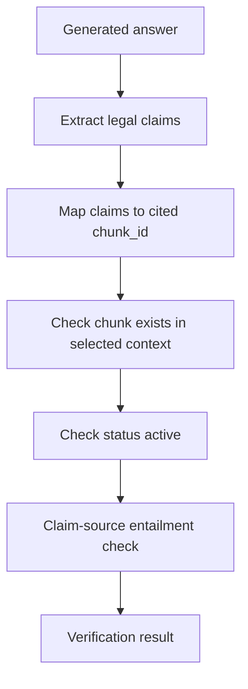

# Citation Verification Specification
## AI Trợ Lý Tra Cứu & Tuân Thủ Quy Định Giao Thông Vận Tải

**Ngày tạo:** 11/06/2026  
**Phiên bản:** v1.0  
**Liên quan:** PRD F03, F04, F05; API `/chat/stream`; UI Citation Detail

---

## 1. Mục tiêu

Citation Verifier đảm bảo mọi khẳng định pháp lý trong câu trả lời có thể truy vết về chunk nguồn trong KB. Nếu không xác minh được, hệ thống không được trình bày câu trả lời như kết luận chắc chắn.

## 2. Citation JSON schema

```json
{
  "citation_id": "uuid",
  "chunk_id": "uuid",
  "doc_id": "uuid",
  "doc_title": "NĐ 336/2025/NĐ-CP",
  "doc_type": "NGHI_DINH",
  "status": "active",
  "effective_date": "2026-03-01",
  "article_num": 9,
  "clause_num": 1,
  "point_num": "a",
  "locator_type": "article",
  "locator_label": "Dieu 9 Khoan 1",
  "section_path": ["Chuong II", "Dieu 9"],
  "section_number": "9",
  "sign_code": null,
  "asset_ids": [],
  "source_url": "https://...",
  "text_snippet": "...",
  "verification_status": "verified",
  "confidence": 0.93
}
```

## 3. Verification status

| Status | Ý nghĩa | UI hiển thị |
|---|---|---|
| `verified` | Claim khớp locator và nội dung chunk nguồn | `Đã đối chiếu` |
| `partial` | Locator đúng nhưng claim chỉ khớp một phần | `Nên đọc thêm nguồn` |
| `unverified` | Không tìm thấy căn cứ trực tiếp trong context | Không hiển thị claim; chuyển guardrail |
| `blocked` | Claim ngoài context hoặc ngoài phạm vi | Không trả claim, chuyển guardrail |

## 4. Quy trình verifier



## 5. Luật kiểm tra

| Rule | Điều kiện đạt |
|---|---|
| Chunk tồn tại | `chunk_id` có trong selected context hoặc KB |
| Văn bản active | Chỉ chunk `status = active`, review approved, đúng khoảng hiệu lực và `rag_enabled=true` được làm căn cứ; văn bản repealed chỉ tạo notice metadata, không được đưa vào context |
| Locator đúng | Locator generic khớp chunk: Điều/Khoản/Điểm hoặc mục kỹ thuật, mã biển, hình, bảng |
| Snippet đủ | `text_snippet` là đoạn ngắn để hiển thị; verifier phải so với `full_text` |
| Claim grounded | So câu/bullet chứa citation với chunk tương ứng sau khi normalize tiếng Việt |

Verifier ghép câu nội dung ngay trước khi citation chỉ là một câu/bullet dẫn
nguồn. Cả claim extraction và lookahead Điều/Khoản dùng chung ranh giới xuống
dòng, `;`, `.`, `?`, `!` và bullet inline (`•`, `●`, `▪`) để không gắn Khoản hoặc
tên văn bản của citation kế tiếp vào claim trước. Dấu `:` không phải ranh giới vì
mẫu `Theo Điều 9: ...` cần giữ locator và nội dung trong cùng claim. Dẫn chiếu nội bộ trong source không
được tạo thành citation độc lập nếu locator đích không được retrieve.

Grounding cho phép paraphrase nhưng mọi số liệu ngoài số Điều/Khoản và số hiệu
văn bản phải xuất hiện trong source; `04` và `4` được chuẩn hóa cùng giá trị. Chỉ
citation `verified`/`partial`, có `doc_id`, `chunk_id` và status active mới được
đưa ra response metadata dạng `provision_citations`. Field legacy `citations` vẫn
được giữ cho tương thích ngược với client hiện tại. Khi output guardrail chặn,
danh sách citation cũng bị xóa.
Citation inactive/historical không được map vào `provision_citations`; nếu cần giữ
tham chiếu vòng đời thì backend đưa chúng vào `historical_references`.
| Source URL | Có source URL hoặc nguồn nội bộ đã xác minh |

Tên hoặc số hiệu văn bản xuất hiện đơn lẻ không đủ để tạo citation `verified`.
Citation pháp lý phải có locator Điều/Khoản/Điểm khớp chunk, hoặc locator kỹ
thuật chính xác như mã biển báo. Không dùng mapping UUID/số văn bản seed trong code.

### 5.1 Fallback citation từ retrieval unit

Nếu LLM không tự viết Điều/Khoản nhưng retrieval đã trả về `RetrievedChunk`
active, backend có thể tạo citation có cấu trúc trực tiếp từ metadata của
retrieval unit. Fallback này chỉ dùng chunk trong selected context, dedupe theo
document/chunk, ưu tiên unit có locator Điều/Khoản/Điểm và điểm retrieval cao.

Với câu hỏi dạng "dẫn căn cứ", "căn cứ nào", "dẫn quy định" hoặc "viện dẫn",
node verification được phép thay câu trả lời rỗng/abstain bằng một câu trả lời
ngắn nêu căn cứ phù hợp nhất và gắn `provision_citation` từ retrieval unit.
Hành vi này không phụ thuộc LLM tự sinh locator và không được tạo citation từ
văn bản ngoài selected context.

## 6. Claim extraction

Verifier cần tách các loại claim sau:

| Claim type | Ví dụ | Yêu cầu citation |
|---|---|---|
| Nghĩa vụ | Xe phải có phù hiệu | Bắt buộc |
| Mức phạt | Phạt 20-24 triệu | Bắt buộc |
| Điều kiện | Phải có GPKD | Bắt buộc |
| Thời hạn | Hiệu lực từ 01/03/2026 | Bắt buộc |
| Cảnh báo hết hiệu lực | NĐ 100/2019 đã hết hiệu lực | Bắt buộc; nguồn hiện hành phải khớp nội dung hỏi, không suy diễn quan hệ thay thế toàn văn |
| Disclaimer | Thông tin tham khảo | Không cần citation |

## 7. Khi verification fail

| Trường hợp | Hành động |
|---|---|
| Một dòng/bullet có locator fail | Xóa trọn dòng/bullet đó, giữ các phần khác, rồi chạy verifier lại |
| Nhiều claim fail | Trả answer an toàn: chưa đủ căn cứ trong KB |
| Citation dẫn văn bản repealed | Chặn citation khỏi final answer; chỉ giữ cảnh báo lifecycle và tìm căn cứ active thay thế |
| LLM bịa Điều/Khoản | Chặn claim, log hallucination event, không cho câu trả lời gốc đi ra `final_response` |

Việc cắt dòng chỉ áp dụng khi chính dòng đó chứa locator pháp lý không được
context xác nhận. Hệ thống không sửa nội dung claim, không đổi locator và không
hạ ngưỡng grounding. Nếu phần còn lại không có citation active ở trạng thái
`verified`/`partial`, output guardrail vẫn thay toàn bộ bằng thông báo không đủ căn cứ.

## 8. Logging

Mỗi lượt trả lời lưu:

| Field | Nơi lưu |
|---|---|
| `citations` | `qa_messages.citations` |
| `provision_citations` | suy ra khi serialize response từ `qa_messages.citations` |
| `historical_references` | suy ra từ citation không còn active hoặc metadata lịch sử riêng |
| `faithfulness_score` | `qa_messages.faithfulness_score` |
| `disclaimer_shown` | `qa_messages.disclaimer_shown` |
| `verification_status` | JSON trong citations |
| `latency_ms` | `qa_messages.latency_ms` |
| `retrieval_trace_id` | Local quality observation / optional external trace metadata |

## 9. Acceptance Criteria

Điểm faithfulness từ verifier có hai vai trò khác nhau: response pháp lý dưới
`0.80` bị output guardrail chặn ngay; release gate đánh giá toàn bộ golden dataset
với trung bình `>= 0.92`, từng case `>= 0.80` và coverage đầy đủ. Thiếu score làm
case/run `invalid`, không được suy diễn là pass.

- 100% answer pháp lý có citation hoặc thông báo không đủ dữ liệu.
- 100% citation click-through được tới `chunk_id`.
- Không hiển thị claim unverified như kết luận chắc chắn; nếu không còn citation `verified`/`partial` hợp lệ thì backend thay toàn bộ final answer bằng guardrail insufficient-context.
- Hallucination rate mục tiêu <= 5%.
- Citation verifier chạy sau LLM generation và trước khi stream final completion event.

## 10. Eval coverage for citation metadata

Golden eval hien tai khoa them cac output sau ben canh citation verifier:

- `provision_citations` chi duoc tinh tu citation `active` va `verified/partial`
- `document_sources` duoc dung cho summary va overview path, khong tron vao provision citations
- `historical_references` giu rieng cho historical/lifecycle path
- prompt injection hoac legal-advice redirect khong duoc de lai citation gia

## 11. Runtime updates 2026-07-09

- Deterministic retrieval-grounded answers are verified by attaching structured citations directly from retrieval units, not by trusting free-form citation text.
- `document_sources` are merged from explicit source metadata and citation-derived source metadata so summary/overview UI does not lose a document when citations already prove it.
- Historical references remain separate from `provision_citations`; inactive or historical material is never serialized as a current legal basis.
- Fallback citation generation is allowed only for answerable retrieval results, and is skipped for clarification, multiple-possibility, or insufficient-evidence guardrail responses.
- If the final answer explicitly names a document that appears in selected retrieval context but the LLM did not produce a verifiable locator for that document, verification may add one structured citation derived from the preferred retrieval unit for that document. This completion is limited to active selected context and is deduped by document.
- Citation completion prefers direct provision units such as Article 3 Clause 1 when available, then the highest-ranked retrieval unit. It does not add every chunk from a mentioned document, to avoid noisy UI and over-citation.
- Direct evidence guardrail responses (`evidence_clarification`, `evidence_multiple_possibilities`, `evidence_insufficient`) must leave `verified_citations` and `provision_citations` empty. These responses ask for clarification or fail closed and must not look like a concluded legal basis.
